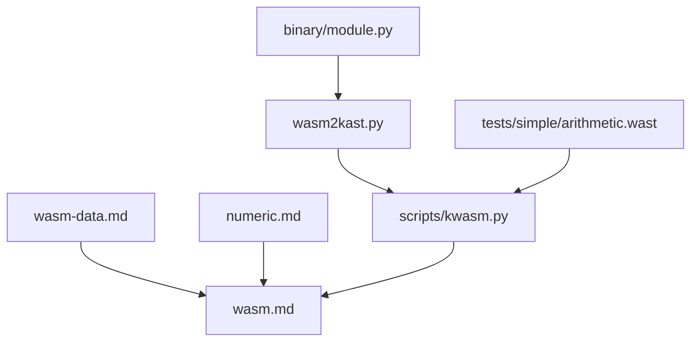

# runtimeverification/wasm-semantics

> Formal semantics of WebAssembly written in K, to execute and prove Wasm programs.

## The problem
Reasoning about WebAssembly requires a precise, executable definition of its behavior.

## What it actually does
The KWasm semantics: `wasm-data.md` (types and values), `numeric.md` (numeric operators) and `wasm.md` (configuration and transition rules). The `./kwasm` script runs `.wast` files or launches proofs, with the LLVM backend (execution) or Haskell backend (symbolic proofs). Python tools analyze the binary.

## How it is wired


## Trying it
```bash
make deps
make build
./kwasm run tests/simple/arithmetic.wast
./kwasm prove tests/proofs/simple-arithmetic-spec.k kwasm-lemmas
make test
```

## Cost and gotchas
Free. Heavy toolchain: K, Pandoc, Haskell Stack, LLVM, exact Z3 4.8.15, Java 8 JDK; Java is not in the list, you have to plan for it. License not identified by GitHub.

## What it is not
Not a production Wasm runtime, despite the README's "production-ready" wording: it is a formal specification.

## Alternatives
No alternative named in the README.

## For you
Ignore: highly specialized formal verification, no use in your data / AI work.
