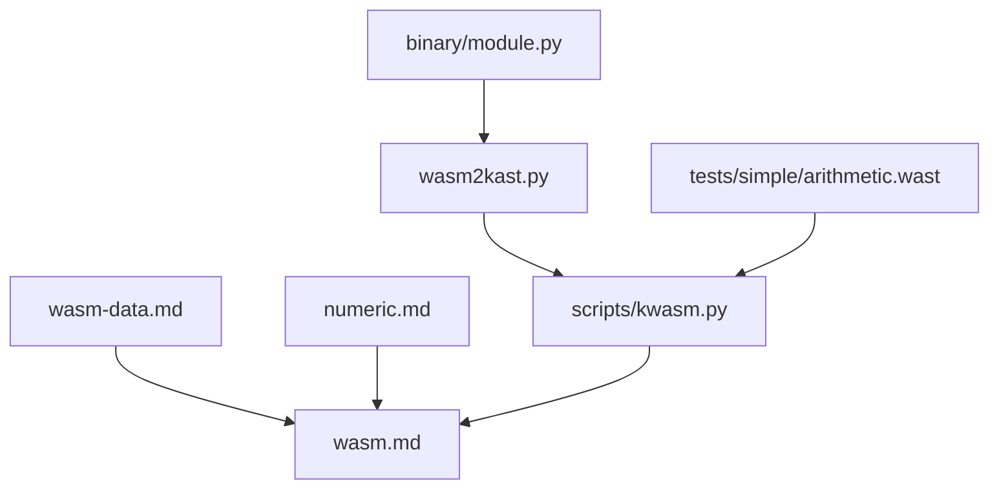

# runtimeverification/wasm-semantics

> Sémantique formelle de WebAssembly écrite en K, pour exécuter et prouver des programmes Wasm.

## Le problème
Raisonner sur du WebAssembly exige une définition précise et exécutable de son comportement.

## Ce que ça fait vraiment
La sémantique KWasm : `wasm-data.md` (types et valeurs), `numeric.md` (opérateurs numériques) et `wasm.md` (configuration et règles de transition). Le script `./kwasm` exécute des fichiers `.wast` ou lance des preuves, avec le backend LLVM (exécution) ou Haskell (preuves symboliques). Des outils Python analysent le binaire.

## Comment c'est branché


## Essayer
```bash
make deps
make build
./kwasm run tests/simple/arithmetic.wast
./kwasm prove tests/proofs/simple-arithmetic-spec.k kwasm-lemmas
make test
```

## Coût et pièges
Gratuit. Chaîne lourde : K, Pandoc, Haskell Stack, LLVM, Z3 4.8.15 exact, Java 8 JDK ; Java n'est pas dans la liste, il faut le prévoir. Licence non identifiée par GitHub.

## Ce que ce n'est pas
Pas un moteur d'exécution Wasm de production, malgré la formule « production-ready » du README : c'est une spécification formelle.

## Alternatives
Aucune alternative nommée dans le README.

## Pour toi
Ignorer : vérification formelle pointue, sans usage dans ton travail data / IA.

