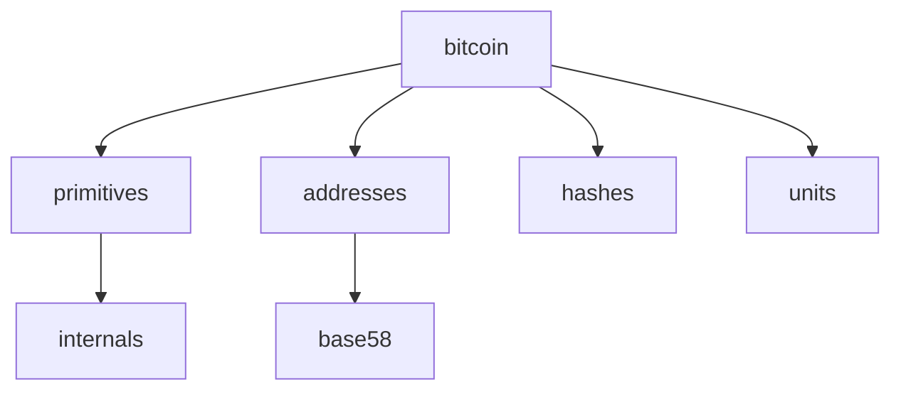

# rust-bitcoin/rust-bitcoin

> Rust library to (de)serialize Bitcoin blocks, transactions, scripts, addresses and keys.

## The problem
Handling the Bitcoin protocol in Rust calls for reliable structures and encodings rather than home-grown reimplementations.

## What it actually does
Cargo workspace of several crates: bitcoin, primitives, addresses, base58, hashes, units, io, internals, chacha20_poly1305. Serialization of network messages, blocks, transactions, scripts, keys and addresses (BIP-0032). Fuzzing, mutation testing and Kani verification in CI.

## How it is wired

## Trying it
No command in the README; the documentation is at docs.rs/bitcoin.

## Cost and gotchas
Free. Rust required (not listed: `none`). The `__unstable` functions fall outside semver. Dependency lockfiles do not guarantee the absence of malicious code.

## What it is not
Not to be used for consensus code (full chain validation): the README forbids it. No altcoin support. Not an RPC client.

## Alternatives
corepc-client, recommended for JSON-RPC with Bitcoin Core.

## For you
Ignore: Bitcoin-specific in Rust, unrelated to data / AI / MLOps work.
