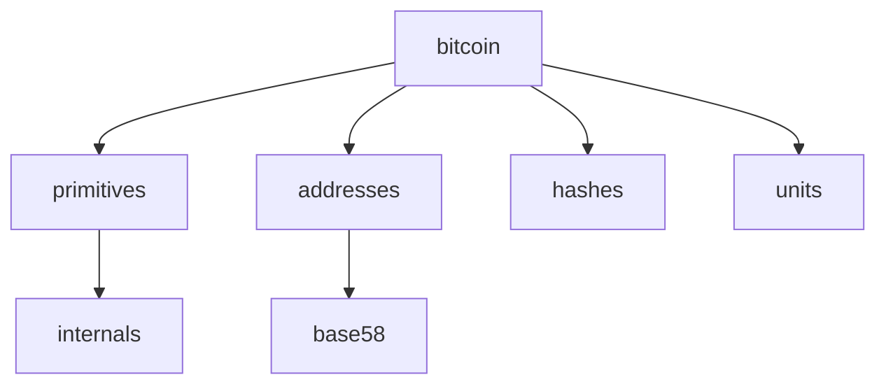

# rust-bitcoin/rust-bitcoin

> Bibliothèque Rust pour (dé)sérialiser blocs, transactions, scripts, adresses et clés Bitcoin.

## Le problème
Manipuler le protocole Bitcoin en Rust demande des structures et des encodages fiables plutôt que des réimplémentations maison.

## Ce que ça fait vraiment
Espace de travail Cargo de plusieurs crates : bitcoin, primitives, addresses, base58, hashes, units, io, internals, chacha20_poly1305. Sérialisation des messages réseau, blocs, transactions, scripts, clés et adresses (BIP-0032). Fuzzing, tests de mutation et vérification Kani en CI.

## Comment c'est branché

## Essayer
Aucune commande dans le README ; la documentation est sur docs.rs/bitcoin.

## Coût et pièges
Gratuit. Rust requis (non listé : `aucun`). Les fonctions `__unstable` sortent du semver. Les verrous de dépendances ne garantissent pas l'absence de code malveillant.

## Ce que ce n'est pas
À ne pas utiliser pour du code de consensus (validation complète de la chaîne) : le README l'interdit. Pas de support des altcoins. Pas un client RPC.

## Alternatives
corepc-client, recommandé pour le JSON-RPC avec Bitcoin Core.

## Pour toi
Ignorer : spécialisé Bitcoin en Rust, sans lien avec un travail data / IA / MLOps.

