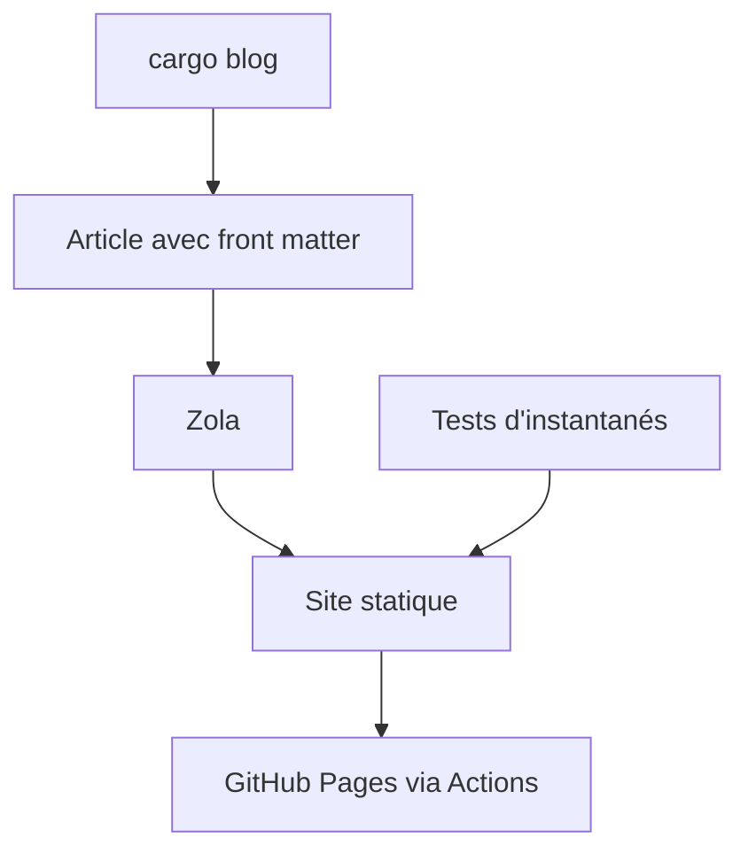

# rust-lang/blog.rust-lang.org

> Sources of the official Rust language blog, generated with Zola and deployed on GitHub Pages.

## The problem
The Rust project needs a versioned blog where anyone can propose posts by pull request.

## What it actually does
The site is built by Zola (version 0.23.6 at minimum) and deployed by GitHub Actions. `cargo blog` generates a post skeleton, posts carry tags with Atom feeds. A snapshot test (cargo-insta) compares the site output between branches.

## How it is wired
Simplified diagram based on the sheet, no diagram provided.


## Trying it
```bash
cargo install --debug --locked --git https://github.com/getzola/zola --rev 1969d846a7ca7536dc547da500bcf9be9c631f40
zola serve --fast --open
cargo blog
cargo insta test -p snapshot --accept --include-ignored
```

## Cost and gotchas
Free. You need the Rust toolchain (cargo) to build Zola and run the tools; snapshots must not be merged.

## What it is not
It is not a reusable tool: it is the source code of a single site.

## Alternatives
No alternative named in the README.

## For you
Ignore: unless you want to contribute to the Rust blog or draw inspiration from a Zola pipeline, it brings nothing to your data / AI work.
