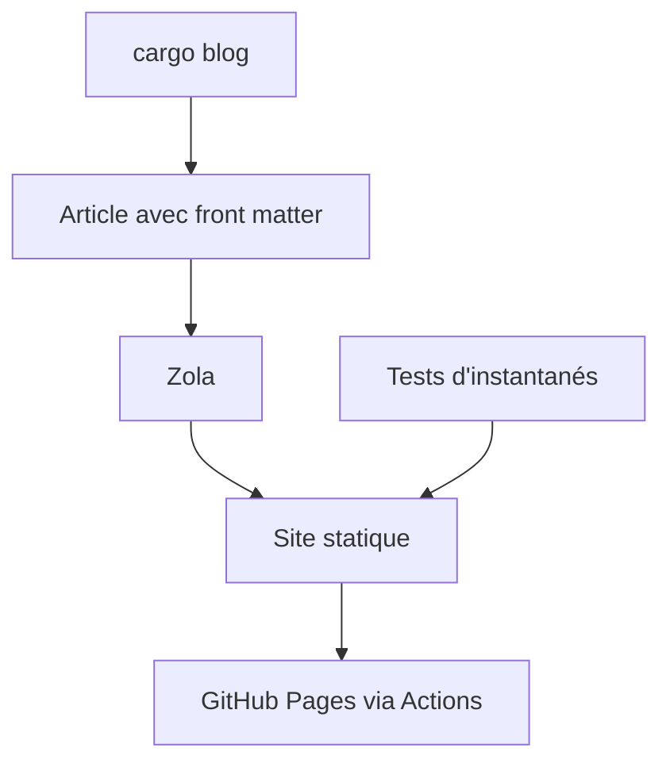

# rust-lang/blog.rust-lang.org

> Sources du blog officiel du langage Rust, générées avec Zola et déployées sur GitHub Pages.

## Le problème
Le projet Rust a besoin d'un blog versionné où chacun peut proposer des articles par pull request.

## Ce que ça fait vraiment
Le site est produit par Zola (version 0.23.6 au minimum) et déployé par GitHub Actions. `cargo blog` génère le squelette d'un article, les billets portent des étiquettes avec flux Atom. Un test d'instantanés (cargo-insta) compare la sortie du site entre branches.

## Comment c'est branché
Schéma simplifié d'après la fiche, sans diagramme fourni.


## Essayer
```bash
cargo install --debug --locked --git https://github.com/getzola/zola --rev 1969d846a7ca7536dc547da500bcf9be9c631f40
zola serve --fast --open
cargo blog
cargo insta test -p snapshot --accept --include-ignored
```

## Coût et pièges
Gratuit. Il faut la chaîne Rust (cargo) pour compiler Zola et lancer les outils ; les instantanés ne doivent pas être fusionnés.

## Ce que ce n'est pas
Ce n'est pas un outil réutilisable : c'est le code source d'un seul site.

## Alternatives
Aucune alternative nommée dans le README.

## Pour toi
À ignorer : sauf si tu veux contribuer au blog Rust ou t'inspirer d'une chaîne Zola, il n'apporte rien à ton travail data / IA.

