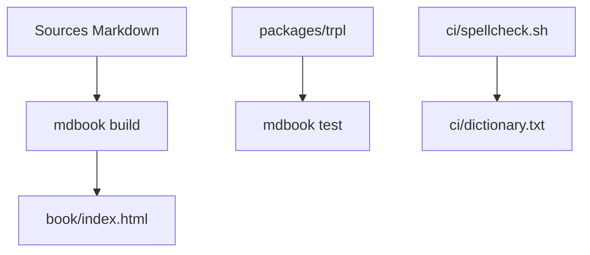

# rust-lang/book

> Source of the official book "The Rust Programming Language", for learning Rust, readable online.

## The problem
Learning Rust without a maintained reference text aligned with the language versions.

## What it actually does
Contains the book's sources, built with mdBook. The book is readable online (stable, beta, nightly) and exists in print from No Starch Press. Releases provide the code of the listings. Translations are in progress.

## How it is wired
Simplified diagram based on the sheet, no diagram provided.



## Trying it
```bash
cargo install mdbook --locked --version <version_num>
mdbook build
cd packages/trpl
mdbook test --library-path packages/trpl/target/debug/deps
```

## Cost and gotchas
Free. Requires Cargo and the mdBook version used by rust-lang/rust. The license is not recognized by GitHub: to be checked.

## What it is not
Not a tool or a library: a book. Reading the online version is enough; the repository is for contributing or building locally.

## Alternatives
None named in the README.

## For you
Worth watching: useful if you have to learn Rust for performance components in MLOps; reading online is enough, no need to clone.
