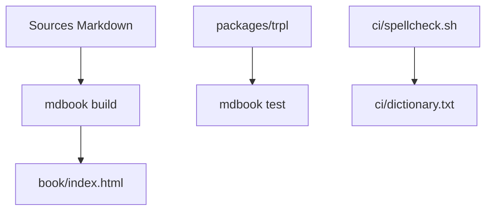

# rust-lang/book

> Source du livre officiel « The Rust Programming Language », pour apprendre Rust, lisible en ligne.

## Le problème
Apprendre Rust sans support de référence maintenu et aligné sur les versions du langage.

## Ce que ça fait vraiment
Contient les sources du livre, construit avec mdBook. Le livre est lisible en ligne (stable, beta, nightly) et existe en version papier chez No Starch Press. Les releases fournissent le code des listings. Des traductions sont en cours.

## Comment c'est branché
Schéma simplifié d'après la fiche, sans diagramme fourni.



## Essayer
```bash
cargo install mdbook --locked --version <version_num>
mdbook build
cd packages/trpl
mdbook test --library-path packages/trpl/target/debug/deps
```

## Coût et pièges
Gratuit. Il faut Cargo et la version de mdBook utilisée par rust-lang/rust. La licence n'est pas reconnue par GitHub : à vérifier.

## Ce que ce n'est pas
Pas un outil ni une bibliothèque : un livre. Lire la version en ligne suffit ; le dépôt sert à contribuer ou construire en local.

## Alternatives
Aucune nommée dans le README.

## Pour toi
À surveiller : utile si tu dois apprendre Rust pour des composants de performance en MLOps, la lecture en ligne suffit sans cloner.

