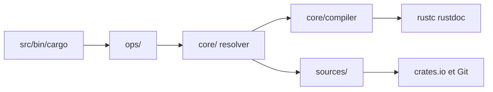

# rust-lang/cargo

> Dependency manager and build tool of the Rust language, for any Rust developer.

## The problem
Downloading a Rust project's dependencies, resolving their versions and calling the compiler in the right order.

## What it actually does
Multi-crate workspace: a subcommand dispatcher, `ops/` for operations (build, publish), a dependency resolver, an orchestrator of `rustc` calls, and source handlers (registry, git, path). Extensible through third-party subcommands and external credential providers.

## How it is wired


## Trying it
```bash
git clone https://github.com/rust-lang/cargo.git
cd cargo
cargo build --release
```

## Cost and gotchas
Free. Cargo shipped with Rust is enough for normal use; building from source requires `rustc`, a C compiler and git, plus OpenSSL on Unix.

## What it is not
This repository is not a usage guide (see the Cargo Book). The crate itself is not designed for external use: its APIs may change.

## Alternatives
No alternative named in the README.

## For you
Adopt only through the standard Rust installation: useful if you write Rust (AI tools, bindings), with no reason to clone this repository otherwise.
