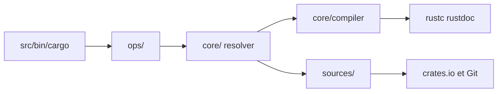

# rust-lang/cargo

> Gestionnaire de dépendances et outil de build du langage Rust, pour tout développeur Rust.

## Le problème
Télécharger les dépendances d'un projet Rust, résoudre leurs versions et appeler le compilateur dans le bon ordre.

## Ce que ça fait vraiment
Workspace multi-crates : un dispatcheur de sous-commandes, `ops/` pour les opérations (build, publish), un résolveur de dépendances, un orchestrateur d'appels à `rustc`, des gestionnaires de sources (registre, git, chemin). Extensible par sous-commandes tierces et fournisseurs d'identifiants externes.

## Comment c'est branché


## Essayer
```bash
git clone https://github.com/rust-lang/cargo.git
cd cargo
cargo build --release
```

## Coût et pièges
Gratuit. Cargo livré avec Rust suffit à l'usage normal ; compiler depuis les sources demande `rustc`, un compilateur C et git, OpenSSL côté Unix.

## Ce que ce n'est pas
Ce dépôt n'est pas un guide d'utilisation (voir le Cargo Book). Le crate lui-même n'est pas conçu pour un usage externe : ses API peuvent changer.

## Alternatives
Aucune alternative nommée dans le README.

## Pour toi
Adopter seulement via l'installation Rust standard : utile si tu écris du Rust (outils d'IA, bindings), sans raison de cloner ce dépôt sinon.

