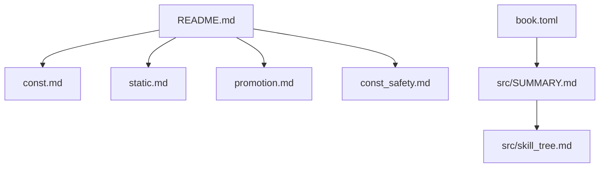

# rust-lang/const-eval

> Design notes on constant evaluation in Rust, for compiler contributors.

## The problem
The rules for compile-time evaluation are spread across many RFCs and discussions.

## What it actually does
Markdown notes on running Rust code at compile time, via the MIR interpreter (miri). They summarize the related RFCs: constant promotion, Drop types in constants, constants in repeat expressions, statically detected bugs as warnings, new features (`loop`, `if`, `match`, `panic!`). An mdBook publishes the tree of unstable features.

## How it is wired


## Trying it
```bash
# aucune commande dans le README : lecture seule des notes
```

## Cost and gotchas
Free. Working notes from the language team; some may be out of date.

## What it is not
Not usage documentation for Rust: it is an internal design document.

## Alternatives
No alternative named in the README.

## For you
Ignore: compiler topic with no effect on your data / AI work.
