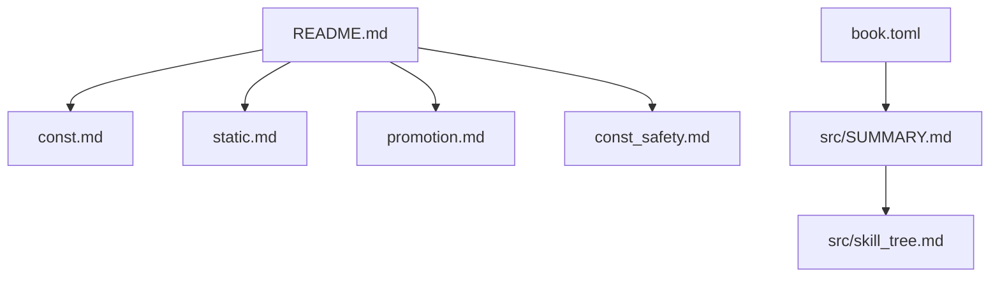

# rust-lang/const-eval

> Notes de conception sur l'évaluation constante en Rust, pour contributeurs au compilateur.

## Le problème
Les règles de l'évaluation à la compilation sont réparties entre de nombreux RFC et discussions.

## Ce que ça fait vraiment
Notes Markdown sur l'exécution de code Rust à la compilation, via l'interpréteur MIR (miri). Elles résument les RFC liés : promotion des constantes, types Drop dans les constantes, constantes dans les expressions de répétition, bugs détectés statiquement en avertissements, nouvelles fonctions (`loop`, `if`, `match`, `panic!`). Un livre mdBook publie l'arbre des fonctionnalités instables.

## Comment c'est branché


## Essayer
```bash
# aucune commande dans le README : lecture seule des notes
```

## Coût et pièges
Gratuit. Notes de travail de l'équipe du langage, certaines peuvent dater.

## Ce que ce n'est pas
Pas une documentation d'usage de Rust : c'est un document de conception interne.

## Alternatives
Aucune alternative nommée dans le README.

## Pour toi
Ignorer : sujet de compilateur sans effet sur ton travail data / IA.

