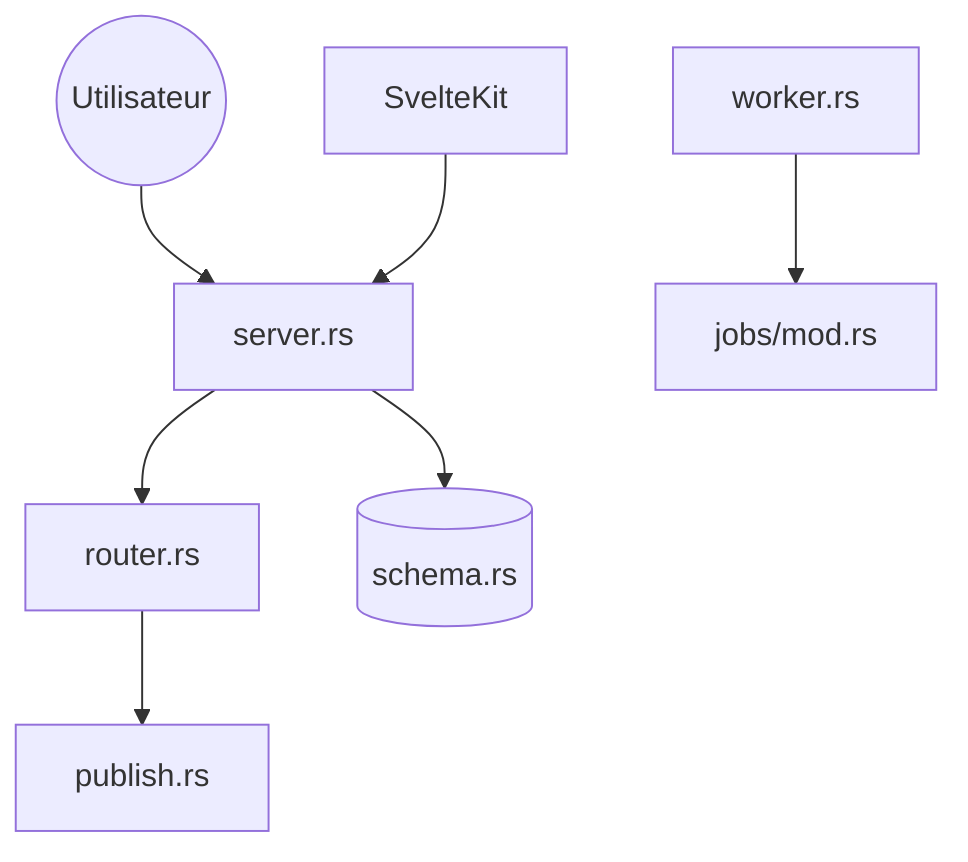

# rust-lang/crates.io

> Source code of the official Rust package registry, site and backend, for the crates.io team.

## The problem
Rust projects need a central registry where they can publish and find "crates".

## What it actually does
- Rust server (Axum) with Diesel database access and a SvelteKit front end.
- Controllers for search, publishing, accounts, tokens and trusted publishing.
- Object storage, email sending, rate limiting.
- Background workers for maintenance tasks.

## How it is wired

## Trying it
No command documented in the README.

## Cost and gotchas
Service hosting: the README mentions file hosting by AWS and CDN by Fastly, donated to the team. Deploying it yourself is not described.

## What it is not
Not a tool to install: it is the code of a service run by the crates.io team. The links between controllers and workers were only partly read.

## Alternatives
No alternative named in the README.

## For you
Ignore: worth reading for its architecture, but you will consume crates.io, not its code.
