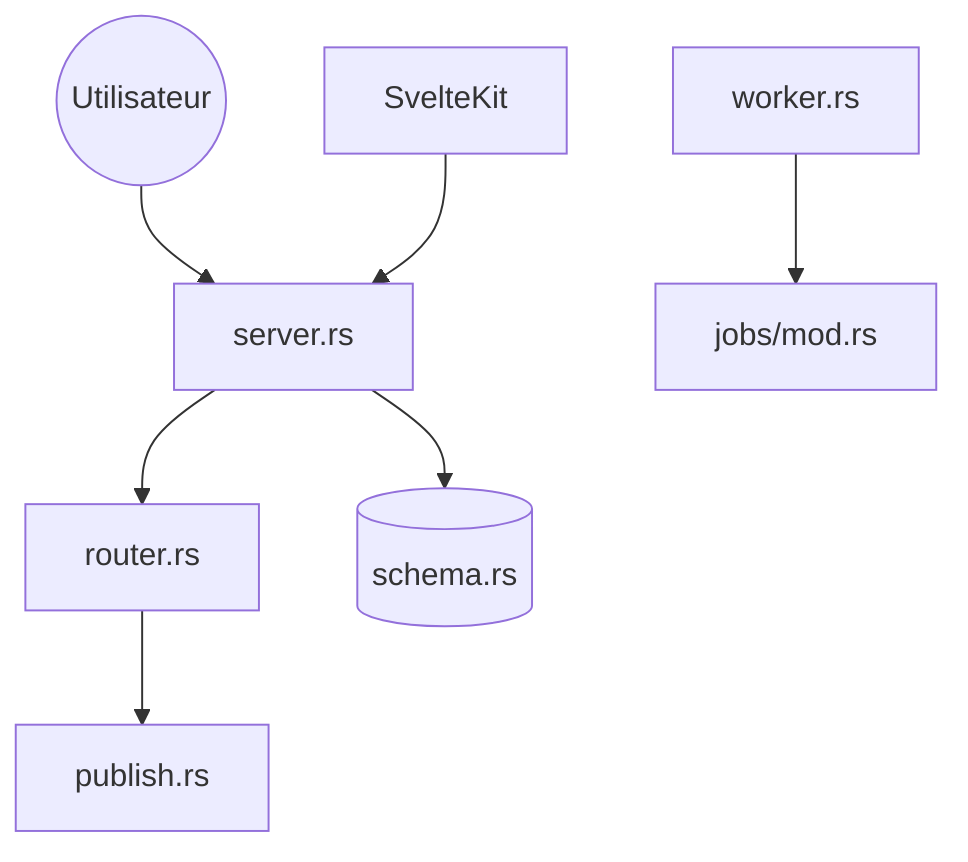

# rust-lang/crates.io

> Code source du registre officiel des paquets Rust, site et backend, pour l'équipe crates.io.

## Le problème
Les projets Rust ont besoin d'un registre central où publier et retrouver des « crates ».

## Ce que ça fait vraiment
- Serveur Rust (Axum) avec accès base Diesel et front SvelteKit.
- Contrôleurs pour recherche, publication, comptes, jetons et publication de confiance.
- Stockage d'objets, envoi d'emails, limitation de débit.
- Des workers en arrière-plan pour les tâches de maintenance.

## Comment c'est branché

## Essayer
Aucune commande documentée dans le README.

## Coût et pièges
Hébergement d'un service : le README cite l'hébergement de fichiers par AWS et le CDN par Fastly, offerts à l'équipe. Le déployer soi-même n'est pas décrit.

## Ce que ce n'est pas
Pas un outil à installer : c'est le code d'un service géré par l'équipe crates.io. Les liens contrôleurs-workers sont en partie non lus.

## Alternatives
Aucune alternative nommée dans le README.

## Pour toi
À ignorer : utile à lire pour l'architecture, mais tu consommeras crates.io, pas son code.

