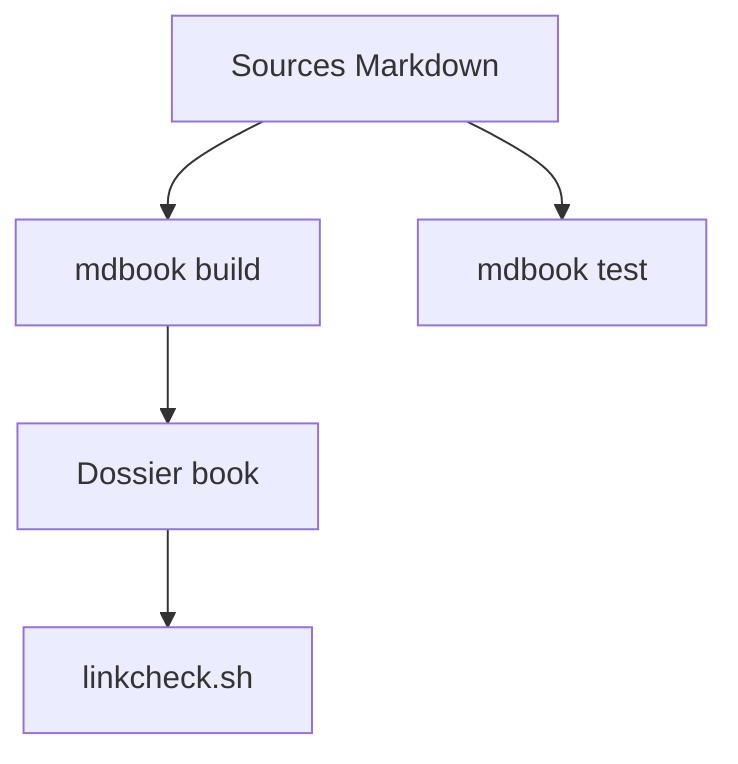

# rust-lang/nomicon

> A book on "unsafe" Rust: what you need to understand to write correct code.

## The problem
Safe Rust is well documented, but the rules of `unsafe` code (raw pointers, invariants) remain obscure and dangerous.

## What it actually does
A book still being written, published by the Rust organization, detailing the subtleties of advanced and unsafe Rust. It is built with mdBook, code examples are tested with `mdbook test` and links are checked with linkcheck.

## How it is wired
Simplified diagram based on the card, no diagram provided.



## Trying it
```bash
cargo install mdbook
mdbook build --open
mdbook test
```

## Cost and gotchas
Free. Rust and cargo are needed to build the book. The text can also be read online; the README does not give the address.

## What it is not
Not an introduction to Rust: the README states that it is a draft that may contain serious errors. No code to reuse.

## Alternatives
None cited in the README.

## For you
Keep an eye on it: a useful reference if you write Rust extensions for Python libraries or data engines, otherwise irrelevant.
