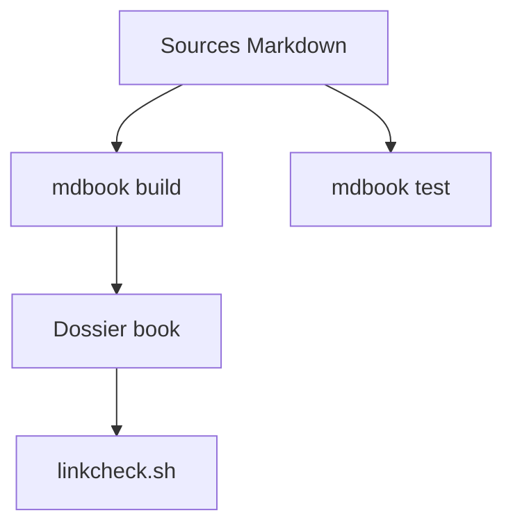

# rust-lang/nomicon

> Livre sur le Rust « unsafe » : ce qu'il faut comprendre pour écrire du code correct.

## Le problème
Le Rust sûr est bien documenté, mais les règles du code `unsafe` (pointeurs bruts, invariants) restent obscures et dangereuses.

## Ce que ça fait vraiment
Un livre en cours de rédaction, publié par l'organisation Rust, qui détaille les subtilités du Rust avancé et non sûr. Il se construit avec mdBook, les exemples de code se testent avec `mdbook test` et les liens se vérifient avec linkcheck.

## Comment c'est branché
Schéma simplifié d'après la fiche, sans diagramme fourni.



## Essayer
```bash
cargo install mdbook
mdbook build --open
mdbook test
```

## Coût et pièges
Gratuit. Il faut Rust et cargo pour construire le livre. Le texte se lit aussi en ligne ; le README ne donne pas l'adresse.

## Ce que ce n'est pas
Pas une introduction au Rust : le README précise qu'il s'agit d'un brouillon pouvant contenir de graves erreurs. Pas de code à réutiliser.

## Alternatives
Aucune citée dans le README.

## Pour toi
À surveiller : référence utile si tu écris des extensions Rust pour des bibliothèques Python ou des moteurs de données, sinon sans objet.

