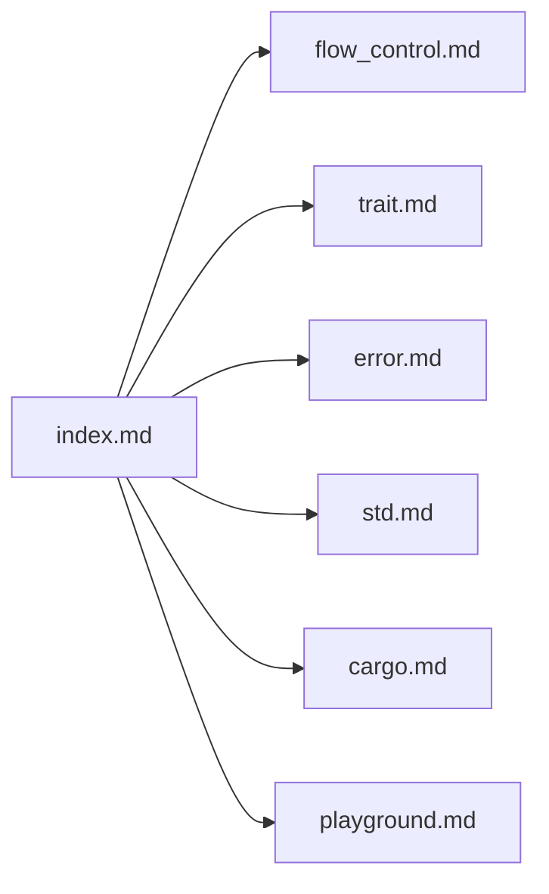

# rust-lang/rust-by-example

> A book for learning Rust through runnable examples, with an online editor.

## The problem
Learning Rust's syntax and idioms requires concrete examples that you can modify and run.

## What it actually does
An mdBook covering the basics (formatting, variables, control flow, functions), types, generics, traits, errors, conversions, the standard library, crates, Cargo, testing and unsafe Rust. Built-in code editor to run the examples (Internet connection required). Translations available.

## How it is wired


## Trying it
```bash
git clone https://github.com/rust-lang/rust-by-example
cd rust-by-example
cargo install mdbook
mdbook build
mdbook serve
```

## Cost and gotchas
Free. Offline reading is possible; running the examples requires Internet.

## What it is not
Not a Rust course for data science, and not a tool.

## Alternatives
None named in the README.

## For you
Worth watching: useful if you are learning Rust for high-performance tooling; otherwise no effect on your daily work.
