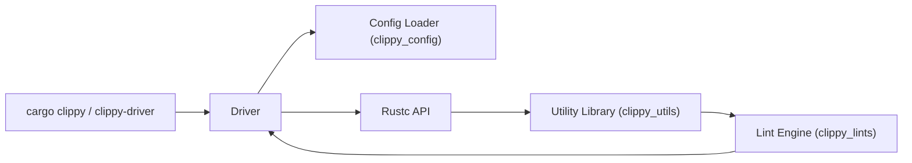

# rust-lang/rust-clippy

> Collection of more than 800 lints that catch common mistakes and non-idiomatic code in Rust.

## The problem
The compiler lets through code that is correct but clumsy, slow or suspicious.

## What it actually does
Clippy plugs into the compiler (rustc driver) and analyzes the AST/HIR with lints grouped into categories (correctness at deny, style, perf, pedantic, restriction, nursery, cargo). It is driven through `cargo clippy` or `clippy-driver`, with `--fix` to apply suggestions and `clippy.toml` to configure some lints (including the minimum Rust version).

## How it is wired


## Trying it
```bash
rustup component add clippy
cargo clippy
cargo clippy --fix
cargo clippy -- -W clippy::pedantic
```

## Cost and gotchas
Free. Do not enable `restriction` wholesale: the lints can contradict each other. `clippy.toml` is not for allowing or denying lints. 2,864 open issues.

## What it is not
Not a formatter (that is rustfmt) nor a security tool. No network: it runs inside the compiler.

## Alternatives
No alternative named in the README.

## For you
Adopt as soon as you write Rust (inference tools, bindings): built into the official toolchain, at no cost.
