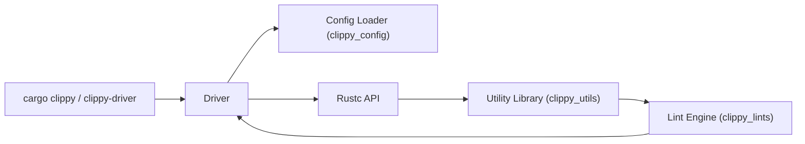

# rust-lang/rust-clippy

> Collection de plus de 800 lints qui repèrent erreurs courantes et code non idiomatique en Rust.

## Le problème
Le compilateur laisse passer du code correct mais maladroit, lent ou suspect.

## Ce que ça fait vraiment
Clippy se branche sur le compilateur (driver rustc) et analyse l'AST/HIR avec des lints regroupés en catégories (correctness en deny, style, perf, pedantic, restriction, nursery, cargo). Il se pilote par `cargo clippy` ou `clippy-driver`, avec `--fix` pour appliquer des suggestions et `clippy.toml` pour configurer certains lints (dont la version Rust minimale).

## Comment c'est branché


## Essayer
```bash
rustup component add clippy
cargo clippy
cargo clippy --fix
cargo clippy -- -W clippy::pedantic
```

## Coût et pièges
Gratuit. N'active pas `restriction` en bloc : les lints peuvent se contredire. `clippy.toml` ne sert pas à autoriser ou refuser des lints. 2 864 issues ouvertes.

## Ce que ce n'est pas
Pas un formateur (c'est rustfmt) ni un outil de sécurité. Pas de réseau : il tourne dans le compilateur.

## Alternatives
Aucune alternative nommée dans le README.

## Pour toi
À adopter dès que tu écris du Rust (outils d'inférence, bindings) : intégré à la chaîne officielle, sans coût.

