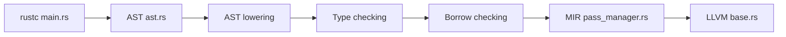

# rust-lang/rust

> Main repository of the Rust language: compiler, standard library and documentation.

## The problem
Writing fast systems code without memory errors or data races.

## What it actually does
The repository contains rustc, the standard library and the documentation. The compiler chains parsing, AST lowering, type and trait checking, borrow checking, MIR and LLVM generation. Cargo, rustfmt, Clippy and rust-analyzer are mentioned. The compiler orchestration links are marked as unverified.

## How it is wired


## Trying it
```bash
# aucune commande dans le README : installation décrite dans le livre « The Book », compilation depuis les sources dans INSTALL.md
```

## Cost and gotchas
Free. Building from source is not recommended. The names Rust and Cargo are trademarks of the Rust Foundation.

## What it is not
Not a tutorial nor an installer: the README points to other pages.

## Alternatives
No alternative named in the README.

## For you
Watch: Rust underpins tools such as uv, Deno or Bun, useful to know for platform components.
