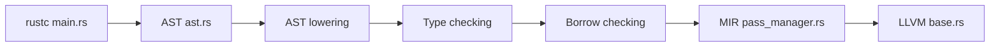

# rust-lang/rust

> Dépôt principal du langage Rust : compilateur, bibliothèque standard et documentation.

## Le problème
Écrire du code système rapide sans erreurs mémoire ni courses de données.

## Ce que ça fait vraiment
Le dépôt contient rustc, la bibliothèque standard et la documentation. Le compilateur enchaîne analyse syntaxique, abaissement de l'AST, vérification des types et traits, emprunts, MIR et génération LLVM. Cargo, rustfmt, Clippy et rust-analyzer sont cités. Les liens d'orchestration du compilateur sont marqués non vérifiés.

## Comment c'est branché


## Essayer
```bash
# aucune commande dans le README : installation décrite dans le livre « The Book », compilation depuis les sources dans INSTALL.md
```

## Coût et pièges
Gratuit. La compilation depuis les sources n'est pas recommandée. Les noms Rust et Cargo sont des marques de la Rust Foundation.

## Ce que ce n'est pas
Pas un tutoriel ni un installeur : le README renvoie à d'autres pages.

## Alternatives
Aucune alternative nommée dans le README.

## Pour toi
À surveiller : Rust sert de base à des outils comme uv, Deno ou Bun, utile à connaître pour des composants de plateforme.

