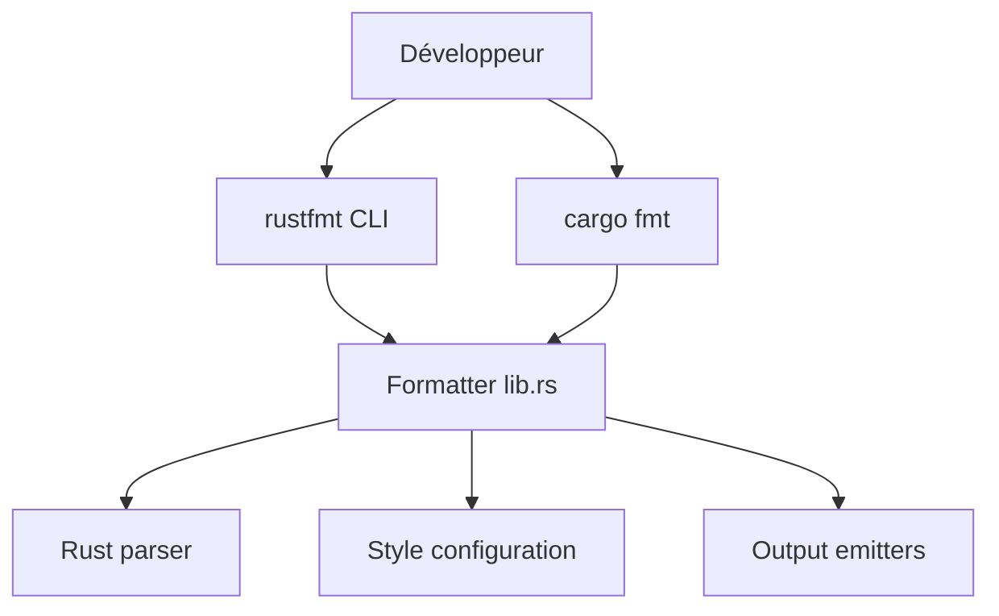

# rust-lang/rustfmt

> Rust code formatter following the official style guide, usable via `cargo fmt`.

## The problem
Without an automatic formatter, code style diverges from one contributor to another and pollutes reviews.

## What it actually does
Parses Rust code into the compiler's AST, rewrites it according to the configured style, then emits the result or a diff. `rustfmt --check` is used in continuous integration. Configuration through `rustfmt.toml` (edition, style_edition), stable or nightly options, `#[rustfmt::skip]` to exclude code. Documented limits: macros, comments and code that does not parse.

## How it is wired
Diagram taken from the code, reduced.



## Trying it
```bash
rustup component add rustfmt
cargo fmt
cargo +nightly fmt
cargo fmt --all -- --check
```

## Cost and gotchas
Free. Real requirement: a Rust toolchain (rustup). With `rustfmt` run directly, the default edition is 2015: set it in `rustfmt.toml`. 947 open issues.

## What it is not
Not a linter (that is clippy). It does not guarantee stable formatting on macros, comments and code fragments.

## Alternatives
No alternative named in the README.

## For you
Adopt as soon as you write Rust (Python extensions, tools): it is the standard formatter and installs with a single command.
