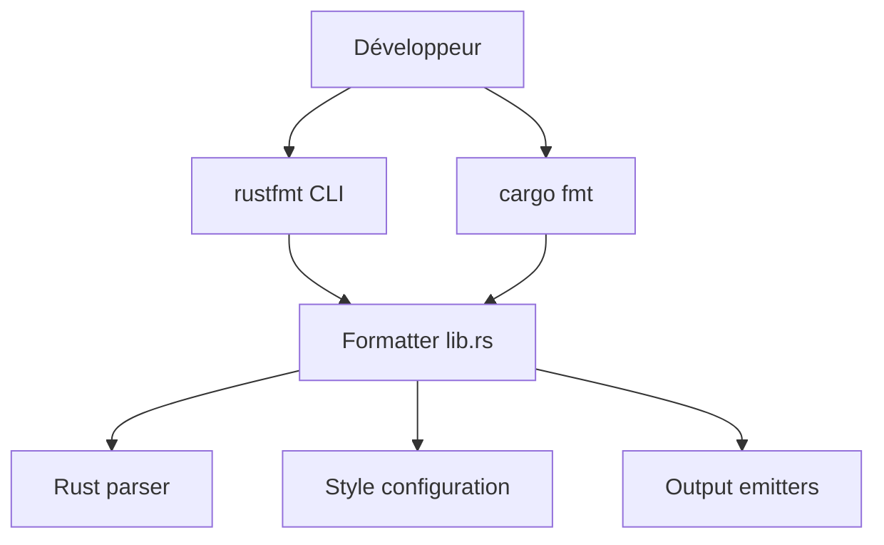

# rust-lang/rustfmt

> Formateur de code Rust selon le guide de style officiel, utilisable via `cargo fmt`.

## Le problème
Sans formateur automatique, le style du code diverge d'un contributeur à l'autre et pollue les revues.

## Ce que ça fait vraiment
Parse le code Rust en AST du compilateur, le réécrit selon le style configuré, puis émet le résultat ou un diff. `rustfmt --check` sert en intégration continue. Configuration par `rustfmt.toml` (edition, style_edition), options stables ou nightly, `#[rustfmt::skip]` pour exclure du code. Limites documentées : macros, commentaires et code qui ne parse pas.

## Comment c'est branché
Diagramme tiré du code, réduit.



## Essayer
```bash
rustup component add rustfmt
cargo fmt
cargo +nightly fmt
cargo fmt --all -- --check
```

## Coût et pièges
Gratuit. Besoin réel : une toolchain Rust (rustup). Avec `rustfmt` direct, l'édition par défaut est 2015 : la fixer dans `rustfmt.toml`. 947 issues ouvertes.

## Ce que ce n'est pas
Pas un linter (c'est clippy). Il ne garantit pas un formatage stable sur macros, commentaires et fragments de code.

## Alternatives
Aucune alternative nommée dans le README.

## Pour toi
À adopter dès que tu écris du Rust (extensions Python, outils) : c'est le formateur standard et il s'installe en une commande.

