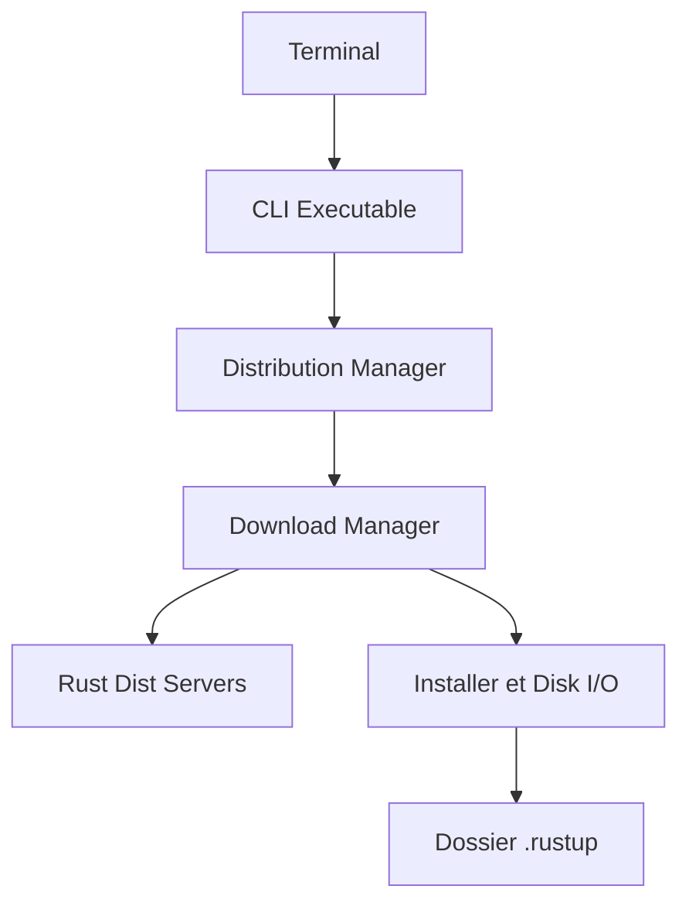

# rust-lang/rustup

> Official Rust toolchain installer: switches between stable, beta and nightly, with cross-compilation targets.

## The problem
Installing, updating and switching between several versions of the Rust compiler by hand is tedious.

## What it actually does
Downloads toolchains from the official distribution channels, installs them under `~/.rustup`, lets you switch between stable, beta or nightly, update them and add standard libraries for other platforms. Works on all platforms supported by Rust, Windows included. It also updates itself.

## How it is wired
Diagram taken from the code, reduced.

## Trying it
The README gives no command; it points to "The Rustup book". The commands `rustup component add rustfmt` and `cargo +nightly fmt` appear in rustfmt's README.

## Cost and gotchas
Free. It downloads from external servers (network access required). 424 open issues.

## What it is not
Not a project dependency manager (that is cargo) nor a compiler: it manages toolchain installation.

## Alternatives
No alternative named in the README.

## For you
Adopt it as soon as you touch Rust (Python extensions, CLI tools): it is the standard, official installation method.
