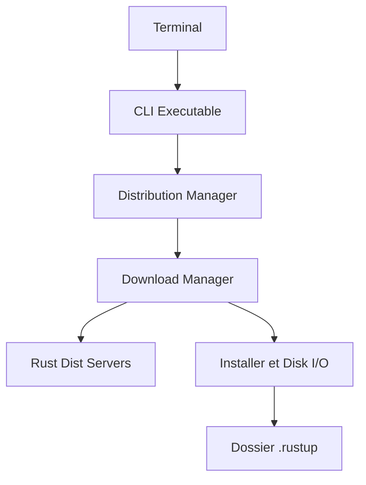

# rust-lang/rustup

> Installeur officiel de la toolchain Rust : bascule entre stable, beta et nightly, avec cibles de compilation croisée.

## Le problème
Installer, mettre à jour et alterner entre plusieurs versions du compilateur Rust à la main est fastidieux.

## Ce que ça fait vraiment
Télécharge les toolchains depuis les canaux de distribution officiels, les installe sous `~/.rustup`, permet de passer de stable à beta ou nightly, de les mettre à jour et d'ajouter des bibliothèques standard pour d'autres plateformes. Fonctionne sur toutes les plateformes supportées par Rust, Windows inclus. Il se met aussi à jour lui-même.

## Comment c'est branché
Diagramme tiré du code, réduit.

## Essayer
Le README ne donne pas de commande ; il renvoie au livre « The Rustup book ». Les commandes `rustup component add rustfmt` et `cargo +nightly fmt` figurent dans le README de rustfmt.

## Coût et pièges
Gratuit. Il télécharge depuis des serveurs externes (accès réseau requis). 424 issues ouvertes.

## Ce que ce n'est pas
Pas un gestionnaire de dépendances de projet (c'est cargo) ni un compilateur : il gère l'installation des toolchains.

## Alternatives
Aucune alternative nommée dans le README.

## Pour toi
À adopter dès que tu touches du Rust (extensions Python, outils CLI) : c'est la méthode d'installation standard et officielle.

