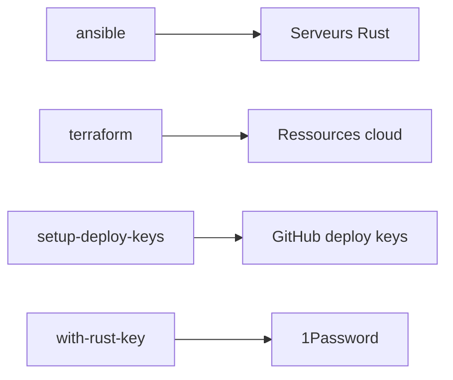

# rust-lang/simpleinfra

> Tools and automation of the Rust infrastructure team: Ansible, Terraform, GitHub actions.

## The problem
The Rust team has to manage its servers, AWS accounts, deploy keys and release signing in a reproducible and secure way.

## What it actually does
Bundles Ansible playbooks, an AWS login with 2FA, shared GitHub actions, `setup-deploy-keys` (GitHub deploy keys instead of personal tokens), the Terraform configuration and `with-rust-key` (GPG signing without writing the key to disk). Several tools require privileges reserved for the team.

## How it is wired


## Trying it
```bash
cargo run --bin setup-deploy-keys org-name/repo-name
cargo run --bin setup-deploy-keys org-name/repo-name --rsa
./with-rust-key.sh gpg tag -u FA1BE5FE 2.0.0 stable
```

## Cost and gotchas
Rust (cargo), a `GITHUB_TOKEN`, the 1Password CLI and `jq` for signing. External contributions: contact `t-infra` on Zulip first, otherwise the repo may close the request.

## What it is not
Not a generic ready-to-use tool: it assumes the Rust project's internal access.

## Alternatives
No alternative named in the README.

## For you
Ignore: mostly useful as an example of a large open source project's infrastructure, not as a tool to adopt.
