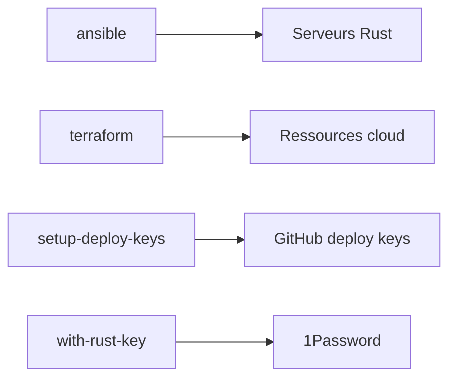

# rust-lang/simpleinfra

> Outils et automatisations de l'équipe infrastructure de Rust : Ansible, Terraform, actions GitHub.

## Le problème
L'équipe Rust doit gérer ses serveurs, comptes AWS, clés de déploiement et signature de versions de façon reproductible et sécurisée.

## Ce que ça fait vraiment
Regroupe des playbooks Ansible, une connexion AWS avec 2FA, des actions GitHub partagées, `setup-deploy-keys` (clés de déploiement GitHub à la place de jetons personnels), la configuration Terraform et `with-rust-key` (signature GPG sans écrire la clé sur disque). Plusieurs outils exigent des privilèges réservés à l'équipe.

## Comment c'est branché


## Essayer
```bash
cargo run --bin setup-deploy-keys org-name/repo-name
cargo run --bin setup-deploy-keys org-name/repo-name --rsa
./with-rust-key.sh gpg tag -u FA1BE5FE 2.0.0 stable
```

## Coût et pièges
Rust (cargo), un `GITHUB_TOKEN`, le CLI 1Password et `jq` pour la signature. Contributions externes : contacter d'abord `t-infra` sur Zulip, sinon le dépôt peut fermer la demande.

## Ce que ce n'est pas
Pas un outil générique prêt à l'emploi : il suppose les accès internes du projet Rust.

## Alternatives
Aucune alternative nommée dans le README.

## Pour toi
À ignorer : utile surtout comme exemple d'infrastructure d'un grand projet open source, pas comme outil à reprendre.

