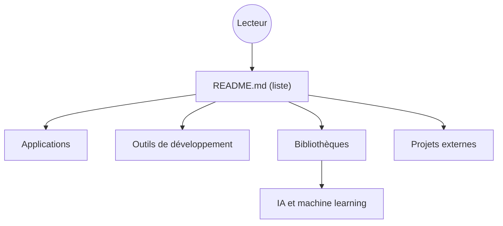

# rust-unofficial/awesome-rust

> Annotated list of Rust projects and resources, by category, for anyone looking for a tool or library.

## The problem
The Rust ecosystem is vast and hard to explore. There is no index sorted by use.

## What it actually does
A table of contents of application categories (audio, blockchain, database, MLOps, observability…) and of libraries (AI, machine learning, data processing, streaming…). Each entry is one line with a link and a description. The README provided is cut off in the Database section: the rest was not read.

## How it is wired
Simplified diagram based on the sheet, no diagram provided.

## Trying it
No documented command: the list is read on GitHub, contributions go through a pull request.

## Cost and gotchas
Free. Entry quality is uneven: some are recent and little proven. The rest of the README was not seen.

## What it is not
Not a quality evaluation or a ranking: it is a directory.

## Alternatives
No alternative named in the README.

## For you
Worth watching: the MLOps, machine learning and data processing sections help spot fast Rust tools.
