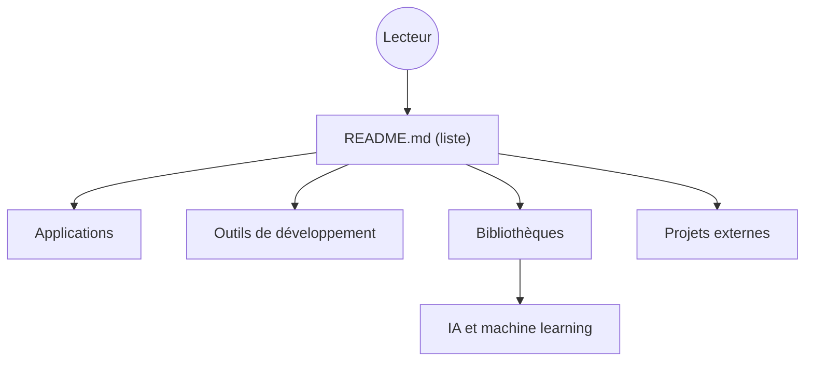

# rust-unofficial/awesome-rust

> Liste commentée de projets et ressources Rust, par catégories, pour qui cherche un outil ou une bibliothèque.

## Le problème
L'écosystème Rust est vaste et difficile à explorer. Il manque un index trié par usage.

## Ce que ça fait vraiment
Une table des matières de catégories d'applications (audio, blockchain, base de données, MLOps, observabilité…) et de bibliothèques (IA, apprentissage automatique, traitement de données, streaming…). Chaque entrée est une ligne avec un lien et une description. Le README fourni est coupé dans la section Base de données : la suite n'a pas été lue.

## Comment c'est branché
Schéma simplifié d'après la fiche, sans diagramme fourni.

## Essayer
Aucune commande documentée : la liste se lit sur GitHub, les contributions passent par une pull request.

## Coût et pièges
Gratuit. La qualité des entrées est inégale : certaines sont récentes et peu éprouvées. La suite du README n'a pas été vue.

## Ce que ce n'est pas
Pas une évaluation de qualité ni un classement : c'est un annuaire.

## Alternatives
Aucune alternative nommée dans le README.

## Pour toi
À surveiller : les rubriques MLOps, machine learning et traitement de données servent à repérer des outils Rust rapides.

