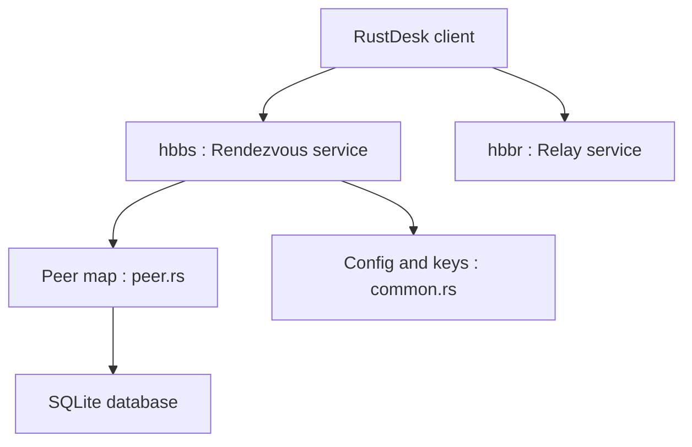

# rustdesk/rustdesk-server

> Self-hosted identification and relay server for RustDesk remote desktop clients.

## The problem
A remote desktop depends on a third-party server for connection setup; self-hosting keeps connections under your control.

## What it actually does
Two executables: `hbbs`, the ID and rendezvous server, and `hbbr`, the relay server. Peer state is kept in SQLite. A command-line utility is provided, plus a desktop manager for Windows. Configuration goes through options, environment variables or a file.

## How it is wired


## Trying it
```bash
cargo build --release
hbbs --help
hbbr --help
```

## Cost and gotchas
Free, AGPL-3.0 license. A reachable server and open ports (hbbs 21116, hbbr 21117 by default) are your responsibility. The Pro version adds more features, paid.

## What it is not
It is not the RustDesk client: you need the client alongside. The free version lacks some features of the Pro version.

## Alternatives
- rustdesk-server-demo: simpler starting point for writing your own server.

## For you
Worth watching: useful for accessing a GPU machine remotely with self-hosting, outside the core of your work.
