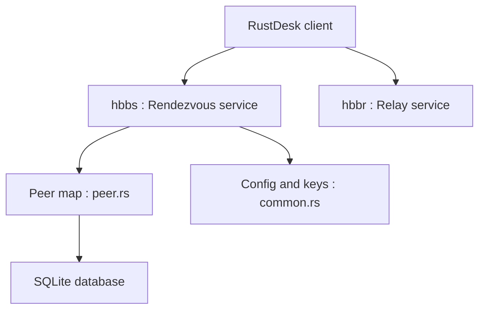

# rustdesk/rustdesk-server

> Serveur d'identification et de relais à héberger soi-même pour les clients de bureau à distance RustDesk.

## Le problème
Un bureau à distance dépend d'un serveur tiers pour la mise en relation ; l'héberger soi-même garde les connexions sous ton contrôle.

## Ce que ça fait vraiment
Deux exécutables : `hbbs`, serveur d'identifiants et de rendez-vous, et `hbbr`, serveur de relais. L'état des pairs est conservé dans SQLite. Un utilitaire en ligne de commande est fourni, plus un gestionnaire de bureau pour Windows. La configuration passe par options, variables d'environnement ou fichier.

## Comment c'est branché


## Essayer
```bash
cargo build --release
hbbs --help
hbbr --help
```

## Coût et pièges
Gratuit, licence AGPL-3.0. Un serveur accessible et des ports ouverts (hbbs 21116, hbbr 21117 par défaut) sont à ta charge. La version Pro apporte plus de fonctions, payante.

## Ce que ce n'est pas
Ce n'est pas le client RustDesk : il faut le client à côté. La version libre n'a pas toutes les fonctions de la version Pro.

## Alternatives
- rustdesk-server-demo : point de départ plus simple pour écrire son propre serveur.

## Pour toi
Surveiller : utile pour accéder à une machine GPU à distance en auto-hébergement, hors du cœur de ton métier.

