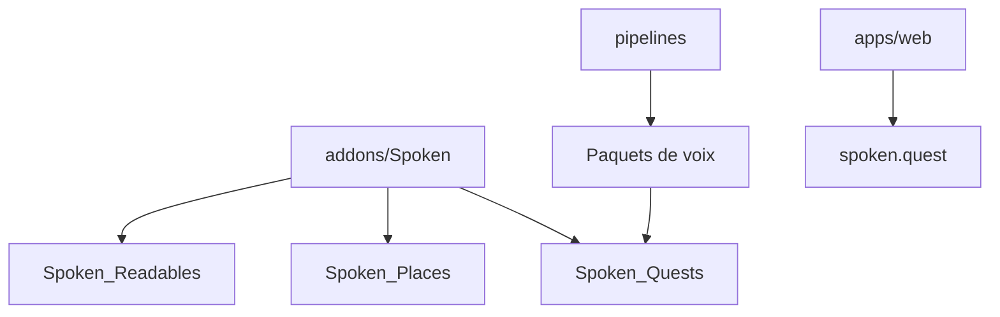

# rusty-key/spoken-wow

> World of Warcraft addon that reads quests, places and texts aloud, for players.

## The problem
The game's quests and lore texts are not voice-acted.

## What it actually does
A Spoken addon and three modules (Quests, Places, Readables) that play voiced dialogues, with subtitles, a narrator window and a compendium. The voice packs (280 to 452 MB each) are downloaded separately, from CurseForge or GitHub. The repository also contains the spoken.quest website and pipelines for generating the corpus and the voices.

## How it is wired


## Trying it
```bash
make help
make package-spoken
make test-player
```

## Cost and gotchas
Free, but you need the game and heavy audio packs. A license is present but not identified. The game's text belongs to Blizzard (see `THIRD_PARTY.md`).

## What it is not
Not a general TTS tool. It only works with World of Warcraft and its pre-generated voices.

## Alternatives
None cited in the README.

## For you
Ignore: game addon unrelated to your work, even though the generated-voice pipeline may be of curiosity interest.
