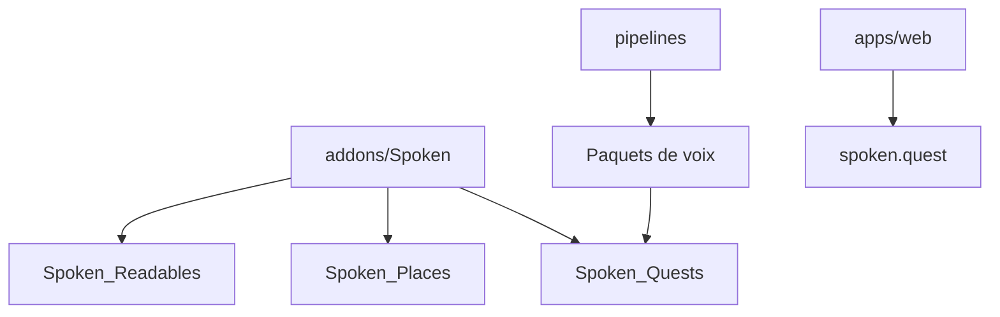

# rusty-key/spoken-wow

> Addon World of Warcraft qui fait lire à voix haute quêtes, lieux et textes, pour joueurs.

## Le problème
Les quêtes et textes de lore du jeu ne sont pas doublés en voix.

## Ce que ça fait vraiment
Un addon Spoken et trois modules (Quests, Places, Readables) qui jouent des dialogues voisés, avec sous-titres, fenêtre de narrateur et compendium. Les paquets de voix (280 à 452 Mo chacun) sont téléchargés à part, depuis CurseForge ou GitHub. Le dépôt contient aussi le site spoken.quest et des pipelines de génération du corpus et des voix.

## Comment c'est branché


## Essayer
```bash
make help
make package-spoken
make test-player
```

## Coût et pièges
Gratuit, mais il faut le jeu et des paquets audio lourds. Licence présente mais non identifiée. Le texte du jeu appartient à Blizzard (voir `THIRD_PARTY.md`).

## Ce que ce n'est pas
Pas un outil de TTS général. Il ne fonctionne qu'avec World of Warcraft et ses voix pré-générées.

## Alternatives
Aucune citée dans le README.

## Pour toi
À ignorer : addon de jeu sans rapport avec ton métier, même si le pipeline de voix générées peut intéresser en curiosité.

