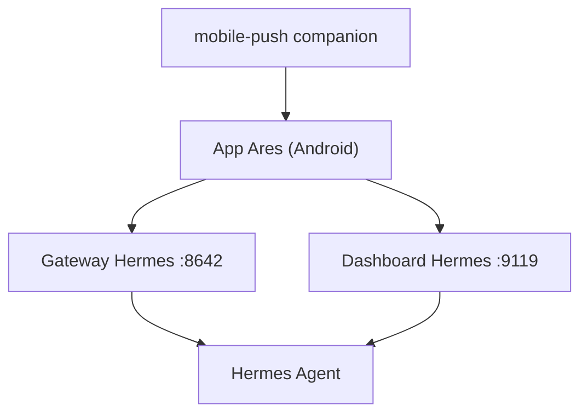

# rusty4444/ares

> Android app (formerly Hermes Android) for chatting with a Hermes agent from a phone or tablet.

## The problem
A Hermes agent runs on a machine; following it, answering its approval requests and reading its results from a phone has no native interface.

## What it actually does
Android client for the Hermes Agent API Gateway: streaming chat (JSON-RPC over WebSocket or REST with SSE), sessions, projects, cron tasks, skills, read-only memory, inline approvals, attachments. Two interfaces, Classic and NextGen, share the same chats. Background notifications require a server component to be installed separately on the Hermes side.

## How it is wired
Simplified diagram based on the sheet, no diagram provided.

## Trying it
The truncated README gives no complete command. Prerequisites mentioned: Hermes Agent installed, Gateway API Server reachable, `API_SERVER_KEY` from `~/.hermes/.env`, APK from the GitHub Releases. On the server: `hermes dashboard --host 0.0.0.0`.

## Cost and gotchas
Free. You need a Hermes Agent already deployed and exposed over local Wi-Fi or Tailscale. Encrypted backups may contain connection secrets.

## What it is not
Not an agent: it is only a client. No background push without the server component, and no delivery guarantee after a force stop.

## Alternatives
No alternative named in the README (NextGen adapts the design of Kyllene).

## For you
Ignore unless you already run Hermes Agent: it is a mobile companion, not a data or MLOps tool.
