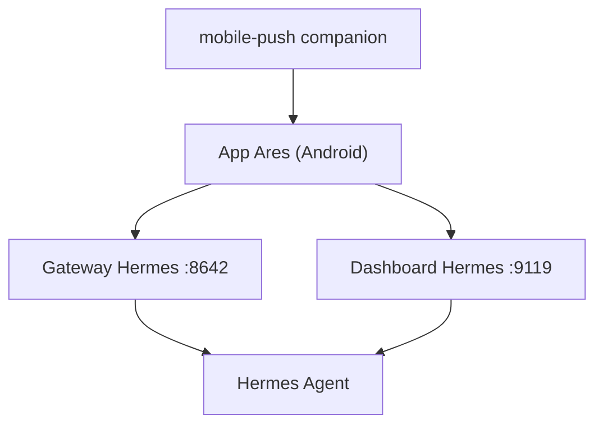

# rusty4444/ares

> Application Android (ex Hermes Android) pour discuter avec un agent Hermes depuis un téléphone ou une tablette.

## Le problème
Un agent Hermes tourne sur une machine ; le suivre, répondre à ses demandes d'approbation et lire ses résultats depuis un téléphone n'a pas d'interface native.

## Ce que ça fait vraiment
Client Android de l'API Gateway de Hermes Agent : chat en streaming (JSON-RPC sur WebSocket ou REST avec SSE), sessions, projets, tâches cron, compétences, mémoire en lecture seule, approbations en ligne, pièces jointes. Deux interfaces, Classic et NextGen, partagent les mêmes chats. Les notifications en arrière-plan exigent un composant serveur à installer séparément côté Hermes.

## Comment c'est branché
Schéma simplifié d'après la fiche, sans diagramme fourni.

## Essayer
Le README tronqué ne donne pas de commande complète. Prérequis cités : Hermes Agent installé, Gateway API Server joignable, `API_SERVER_KEY` de `~/.hermes/.env`, APK depuis les GitHub Releases. Sur le serveur : `hermes dashboard --host 0.0.0.0`.

## Coût et pièges
Gratuit. Il faut un Hermes Agent déjà déployé et exposé en Wi-Fi local ou Tailscale. Les sauvegardes chiffrées peuvent contenir des secrets de connexion.

## Ce que ce n'est pas
Pas un agent : c'est seulement un client. Pas de push en arrière-plan sans le composant serveur, et pas de garantie de livraison après un arrêt forcé.

## Alternatives
Aucune alternative nommée dans le README (NextGen adapte la conception de Kyllene).

## Pour toi
À ignorer sauf si tu exploites déjà Hermes Agent : c'est un compagnon mobile, pas un outil data ou MLOps.

