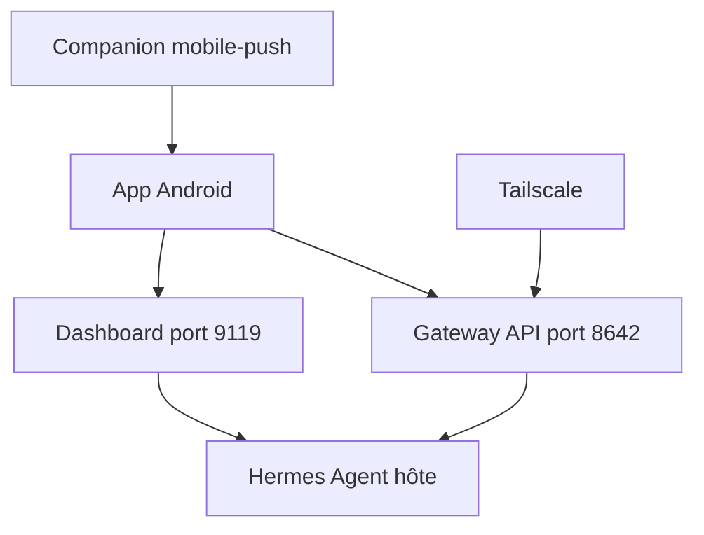

# rusty4444/hermes-android

> Android client to chat with your Hermes Agent sessions from a phone over Wi-Fi or Tailscale.

## The problem
Hermes Agent runs on a host machine. Without a mobile client, you cannot follow or restart your sessions away from the workstation.

## What it actually does
Streaming chat with Hermes through a JSON-RPC gateway over WebSocket or REST with SSE. It handles attachments, per-conversation model choice, voice dictation, synced pins, cron task management, a skills browser, a memory viewer and background notifications. Ten color palettes.

## How it is wired
Simplified diagram based on the sheet, no diagram provided.



## Trying it
```bash
adb install -r app-arm64-v8a-release.apk
hermes dashboard --host 0.0.0.0 --port 9119 --no-open
```
Then in the app: add a connection with the host IP, port 8642 and `API_SERVER_KEY`.

## Cost and gotchas
Free, but Hermes Agent must be installed and reachable from the phone. Background notifications require a server component installed separately. Backups may contain secrets. The app checks for updates on GitHub at launch.

## What it is not
It is not an agent: it assumes an existing Hermes Agent. File downloads are limited to 25 MiB. The README is truncated before the end.

## Alternatives
No alternative named in the README.

## For you
Worth watching: relevant only if you use Hermes Agent, to drive your agents from a phone.
