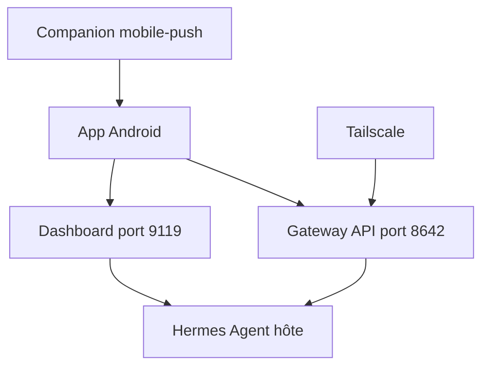

# rusty4444/hermes-android

> Client Android pour dialoguer avec ses sessions Hermes Agent depuis un téléphone via Wi-Fi ou Tailscale.

## Le problème
Hermes Agent tourne sur une machine hôte. Sans client mobile, impossible de suivre ou relancer ses sessions hors du poste.

## Ce que ça fait vraiment
Chat en streaming avec Hermes via passerelle JSON-RPC sur WebSocket ou REST avec SSE. Il gère pièces jointes, choix de modèle par discussion, dictée vocale, épingles synchronisées, gestion des tâches cron, navigateur de skills, visionneuse de mémoire et notifications en arrière-plan. Dix palettes de couleurs.

## Comment c'est branché
Schéma simplifié d'après la fiche, sans diagramme fourni.



## Essayer
```bash
adb install -r app-arm64-v8a-release.apk
hermes dashboard --host 0.0.0.0 --port 9119 --no-open
```
Puis dans l'app : ajouter une connexion avec l'IP de l'hôte, le port 8642 et `API_SERVER_KEY`.

## Coût et pièges
Gratuit, mais Hermes Agent doit être installé et joignable depuis le téléphone. Les notifications d'arrière-plan exigent un composant serveur installé à part. Les sauvegardes peuvent contenir des secrets. L'application vérifie les mises à jour sur GitHub au lancement.

## Ce que ce n'est pas
Ce n'est pas un agent : il suppose un Hermes Agent existant. Les téléchargements de fichiers sont limités à 25 MiB. Le README est tronqué avant la fin.

## Alternatives
Aucune alternative nommée dans le README.

## Pour toi
À surveiller : pertinent seulement si tu utilises Hermes Agent, pour piloter tes agents depuis un téléphone.

