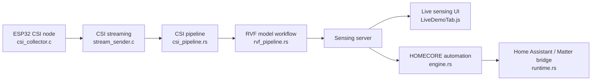

# ruvnet/RuView

> WiFi-based detection platform (CSI on ESP32): presence, breathing, and posture detection, integrated with local home automation.

## The problem
Detecting the presence or vital signs within a room requires the use of cameras or wearable sensors, which raise concerns about privacy and the need for cabling.

## What it actually does
ESP32 cards (≈ $9) measure WiFi signal strength; a Rust-based server extracts data on presence, movement, breathing, heart rate, falls, and a 17-point pose. Pre-trained models are available on Hugging Face, and a catalog of 105 "cogs" expands the functionality. An MQTT/Matter gateway exposes 21 entities to Home Assistant, Apple Home, Google Home, or Alexa. An npm package (`@ruvnet/ruview`) provides an MCP server and a Claude Code plugin. The README itself corrects the figures: presence at 82.3%, "first-cut" pose to PCK@20 = 3%, MM-Fi pose at 82.69% in a benchmark.

## How it is wired


## Trying it
```bash
docker pull ruvnet/wifi-densepose:latest
export RUVIEW_API_TOKEN=$(openssl rand -hex 32)
docker run -p 127.0.0.1:3000:3000 -e RUVIEW_API_TOKEN ruvnet/wifi-densepose:latest
# puis http://localhost:3000 (données simulées)
npx @ruvnet/ruview@0.9.1 doctor
pip install ruview
python archive/v1/data/proof/verify.py
```

## Cost and gotchas
Docker runs using simulated data; the real CSI requires hardware (ESP32-S3 ≈ $9, ~ $140 with Cognitum Seed). The `RUVIEW_API_TOKEN` token is required; otherwise, the container will stop. A weight file published by `safetensors` is rejected (issue #1522).

## What it is not
Neither a medical device nor an emergency system: the user manual requires independent validation before any operational use. Using a single ESP32 for live operation is insufficient, and re-identification of individuals cannot be performed solely on WiFi. The scope is very broad (105 modules, 205 ADR, 478 open issues) and includes sensitive scenarios (person monitoring): monitoring third parties without their knowledge falls under local law.

## Alternatives
There is no alternative mentioned in the README that is comparable; `ruvnet/rvcsi` (a separate runtime CSI) is a subset of it.

## For you
Things to watch out for: a research base with a strong focus on edge MLOps (8 Ko models, reproducible results), but with uneven maturity, an overly broad scope, and only one maintainer; only adopt it if you have ESP32 hardware readily available and a clearly defined use case.
