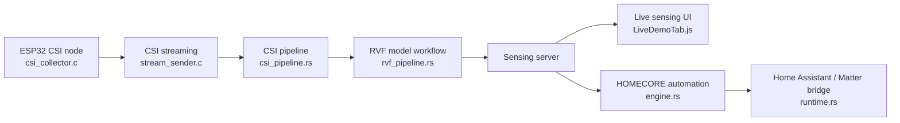

# ruvnet/RuView

> Plateforme de détection par WiFi (CSI sur ESP32) : présence, respiration, pose, intégrée à la domotique locale.

## Le problème
Détecter la présence ou les signes vitaux dans une pièce oblige à poser des caméras ou des capteurs portés, avec leurs contraintes de vie privée et de câblage.

## Ce que ça fait vraiment
Des cartes ESP32 (≈ 9 $) mesurent le CSI des ondes WiFi ; un serveur Rust en tire présence, mouvement, respiration, rythme cardiaque, chutes et une pose à 17 points. Des modèles pré-entraînés sont publiés sur Hugging Face et un catalogue de 105 « cogs » étend l'ensemble. Une passerelle MQTT/Matter expose 21 entités à Home Assistant, Apple Home, Google Home ou Alexa. Un harnais npm (`@ruvnet/ruview`) offre un serveur MCP et un plugin Claude Code. Le README lui-même corrige ses chiffres : présence à 82,3 %, pose embarquée « first-cut » à PCK@20 = 3 %, pose MM-Fi à 82,69 % en benchmark.

## Comment c'est branché


## Essayer
```bash
docker pull ruvnet/wifi-densepose:latest
export RUVIEW_API_TOKEN=$(openssl rand -hex 32)
docker run -p 127.0.0.1:3000:3000 -e RUVIEW_API_TOKEN ruvnet/wifi-densepose:latest
# puis http://localhost:3000 (données simulées)
npx @ruvnet/ruview@0.9.1 doctor
pip install ruview
python archive/v1/data/proof/verify.py
```

## Coût et pièges
Le Docker tourne en données simulées ; le vrai CSI exige du matériel (ESP32-S3 ≈ 9 $, ~140 $ avec Cognitum Seed). Le jeton `RUVIEW_API_TOKEN` est obligatoire, sinon le conteneur s'arrête. Un fichier de poids publié est rejeté par `safetensors` (issue #1522).

## Ce que ce n'est pas
Ni un dispositif médical ni un système d'urgence : le README impose une validation indépendante avant tout usage opérationnel. La pose live sur un seul ESP32 reste insuffisante, et la ré-identification de personnes n'est pas séparable sur WiFi seul. Le périmètre est très large (105 modules, 205 ADR, 478 issues ouvertes) et inclut des scénarios sensibles (surveillance de personnes) : la surveillance de tiers à leur insu relève du droit local.

## Alternatives
Aucune alternative nommée dans le README qui soit comparable ; `ruvnet/rvcsi` (runtime CSI séparé) en est un sous-ensemble.

## Pour toi
À surveiller : base de recherche riche en MLOps edge (modèles 8 Ko, preuves reproductibles), mais maturité inégale, périmètre démesuré et un seul mainteneur ; ne l'adopte qu'avec du matériel ESP32 sous la main et un cas d'usage consenti.

