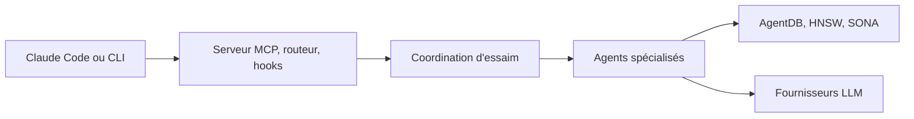

# ruvnet/claude-flow

> Ruflo, formerly Claude Flow: an orchestration layer for agents for Claude Code and Codex.

## The problem
Claude Code operates independently, without shared memory or coordination between agents.

## What it actually does
Adds to Claude Code an MCP server, hooks, over 100 agents, coordinated swarms, a vector memory (AgentDB, HNSW), routing between providers, and a plugin system (35 plugins). Two installation methods: lightweight plugins (slash commands) or `npx ruflo init` (files `.claude/`, hooks, daemon). Web interface and goal planner are in beta.

## How it is wired


## Trying it
```bash
npx ruflo@latest init wizard
claude mcp add claude-flow -- npx ruflo@latest mcp start
/plugin marketplace add ruvnet/ruflo
```

## Cost and gotchas
Supplier tokens under your responsibility, multiplied by the swarms. The `init` command creates many files in the repository. Some federation commands still use the old name `claude-flow`.

## What it is not
The figures (89% routing, speed improvements) are provided by the author and are not reproduced here. The architectural diagram provided describes version 2 alpha and differs from the current README.

## Alternatives
No other alternatives besides LangGraph, AutoGen, and CrewAI are mentioned in the README, which are only listed as benchmark comparisons.

## For you
Things to watch out for: a very ambitious and vaguely defined project from an individual; to be tested in a sandbox environment, with an undeclared license.
