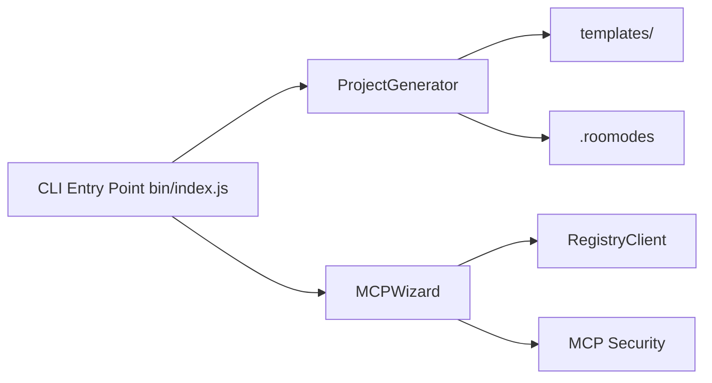

# ruvnet/rUv-dev

> `create-sparc` project generator that configures Roo Code with the SPARC method and MCP servers.

## The problem
Structuring AI-driven development (specification, architecture, tests, security) requires configuring modes, rules and connectors by hand.

## What it actually does
An npx CLI creates the `.roo` and `.roomodes` files that define specialized modes (orchestrator, architect, TDD tester, security, DevOps, etc.). Three templates: SPARC, AIGI (AI code generation) and a minimal Roo framework. An MCP wizard configures servers (Supabase, OpenAI, GitHub, AWS, Firebase) with references to environment variables, security audit and validation.

## How it is wired


## Trying it
```bash
npx create-sparc init
npx create-sparc aigi init my-project
npx create-sparc minimal init my-project
npx create-sparc configure-mcp
```

## Cost and gotchas
Requires the Roo Code VS Code extension and paid models (Claude, GPT, DeepSeek): API costs are on you. The MCP servers require tokens (Supabase, GitHub…).

## What it is not
It is not an autonomous agent: it only generates configuration files for Roo Code. The README gives no measure of the quality of the code produced.

## Alternatives
No alternative named in the README.

## For you
Worth watching: useful if you already use Roo Code and want a ready-made set of modes; otherwise, it is configuration you would rewrite yourself.
