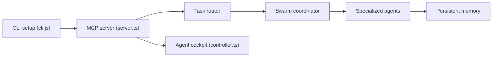

# ruvnet/ruflo

> Meta-harness for Claude Code and Codex: swarms of agents, vector memory, federation, and plugins.

## The problem
The code agents work independently, without shared memory or coordination, and without any safeguards between machines.

## What it actually does
`npx ruflo init` adds specialized agents, hooks, an MCP server, an HNSW memory (AgentDB), task routing, and "swarms" to various topologies. It also includes 35 Claude Code plugins, a console, machine federation, and a security module. The figures (89% routing, acceleration) come from the README and are not verified here; the architectural diagram is presented as conceptual.

## How it is wired


## Trying it
```bash
npx ruflo@latest init wizard
claude mcp add claude-flow -- npx ruflo@latest mcp start
/plugin marketplace add ruvnet/ruflo
/plugin install ruflo-core@ruflo
```

## Cost and gotchas
These are your responsibility; multiple agents increase consumption. The installation creates `.claude/`, `.claude-flow/`, hooks, and a daemon. The mods run with your account's permissions and are not sandboxed (as noted in the README). There are almost 1,000 open issues.

## What it is not
Not required for using Claude Code. The described learning approach is "conceptual": it requires pre-trained embeddings and configured modules. The examples provided (Claude Flow) do not demonstrate absolute precedence.

## Alternatives
- Claude Code, on its own: simpler, without a coordination layer.
- agentic-qe-fleet: an external QE plugin that can be installed from the same marketplace.

## For you
Things to watch out for: ambitious in terms of memory and multi-agent capabilities, but the range is very large (314 MCP tools); try a single plugin before committing to a full `init`.
