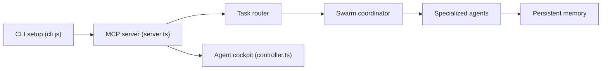

# ruvnet/ruflo

> Méta-harnais pour Claude Code et Codex : essaims d'agents, mémoire vectorielle, fédération et plugins.

## Le problème
Les agents de code travaillent isolés, sans mémoire partagée ni coordination, et sans garde-fous entre machines.

## Ce que ça fait vraiment
`npx ruflo init` ajoute à un projet des agents spécialisés, des hooks, un serveur MCP, une mémoire HNSW (AgentDB), du routage de tâches et des « swarms » aux topologies variées. S'ajoutent 35 plugins Claude Code, une console, une fédération entre machines et un module de sécurité. Les chiffres (89 % de routage, accélérations) viennent du README et ne sont pas vérifiés ici ; le schéma d'architecture est annoncé conceptuel.

## Comment c'est branché


## Essayer
```bash
npx ruflo@latest init wizard
claude mcp add claude-flow -- npx ruflo@latest mcp start
/plugin marketplace add ruvnet/ruflo
/plugin install ruflo-core@ruflo
```

## Coût et pièges
Tokens à ta charge ; les agents multiples multiplient la consommation. Le dépôt installe `.claude/`, `.claude-flow/`, hooks et daemon. Les mods tournent avec les permissions de ton compte et ne sont pas sandboxés (avertissement du README). Presque 1 000 issues ouvertes.

## Ce que ce n'est pas
Pas obligatoire pour utiliser Claude Code. L'apprentissage décrit est « conceptuel » : il exige embeddings et modules configurés. Les citations de lignée (Claude Flow) ne prouvent pas une antériorité absolue.

## Alternatives
- Claude Code seul : plus simple, sans couche de coordination.
- agentic-qe-fleet : plugin QE externe installable depuis le même marketplace.

## Pour toi
À surveiller : ambitieux sur la mémoire et le multi-agents, mais la surface est énorme (314 outils MCP) ; essaie un seul plugin avant d'engager un `init` complet.

