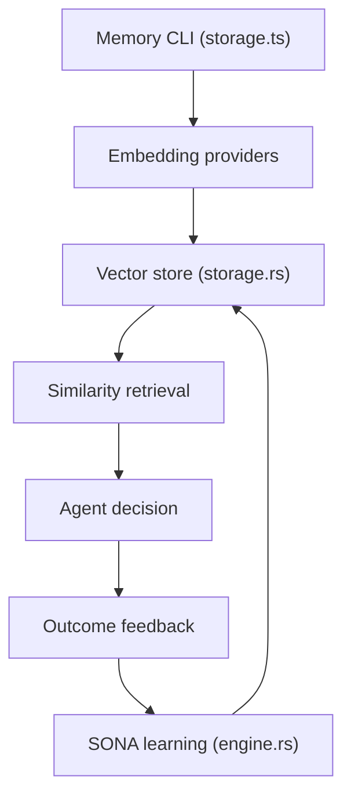

# ruvnet/ruvector

> Local vector memory in Rust for AI agents, with search, graph and an MCP server.

## The problem
An agent forgets everything from one session to the next. Without persistent, local memory, you have to pay for embedding calls or paste the context back by hand.

## What it actually does
Stores vectors and their metadata on disk, retrieves by similarity, with filters. Local embeddings (ONNX model downloaded on first use). Adds a graph, feedback-based learning (SONA) and an MCP server in a read-only profile. The README specifies that learning is not triggered by a mere read and that the core's quantization is not applied.

## How it is wired
Diagram based on the one provided.



## Trying it
```bash
npm install ruvector
npx ruvector info
npx ruvector hooks remember --semantic --type decision \
  "The customer requires all inference to remain in Canada."
npx ruvector hooks recall --semantic --top-k 3 \
  "Where may customer data be processed?"
```

## Cost and gotchas
Free, everything runs locally; the first semantic call downloads a model. Installing `ruvector` does not install the dozens of other packages in the monorepo, and maturity varies by package.

## What it is not
Not a production-ready database on its own: the application decides what to remember and what to believe. The typed decision engine is a separate package. The README is a very broad showcase, hard to gauge.

## Alternatives
No alternative named in the README (Ruflo and MetaHarness are complements, not competitors).

## For you
Worth watching: the idea of local agent memory with MCP is useful for MLOps, but the huge scope and the single maintainer call for a test on a small case before adopting.
