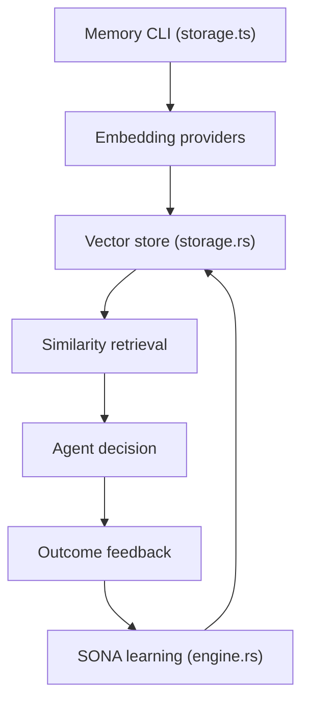

# ruvnet/ruvector

> Mémoire vectorielle locale en Rust pour agents IA, avec recherche, graphe et serveur MCP.

## Le problème
Un agent oublie tout d'une session à l'autre. Sans mémoire persistante et locale, il faut payer des appels d'embedding ou recoller le contexte à la main.

## Ce que ça fait vraiment
Stocke des vecteurs et leurs métadonnées sur disque, retrouve par similarité, avec filtres. Embeddings locaux (modèle ONNX téléchargé au premier usage). Ajoute graphe, apprentissage par retour (SONA) et un serveur MCP en profil lecture seule. Le README précise que l'apprentissage ne se déclenche pas par simple lecture et que la quantification du cœur n'est pas appliquée.

## Comment c'est branché
Schéma d'après le diagramme fourni.



## Essayer
```bash
npm install ruvector
npx ruvector info
npx ruvector hooks remember --semantic --type decision \
  "The customer requires all inference to remain in Canada."
npx ruvector hooks recall --semantic --top-k 3 \
  "Where may customer data be processed?"
```

## Coût et pièges
Gratuit, tout tourne en local ; le premier appel sémantique télécharge un modèle. Installer `ruvector` n'installe pas les dizaines d'autres paquets du monorepo, et la maturité varie selon le paquet.

## Ce que ce n'est pas
Pas une base de données prête pour la production à elle seule : l'application décide quoi mémoriser et quoi croire. Le moteur de décisions typées est un paquet séparé. Le README est une vitrine très large, difficile à jauger.

## Alternatives
Aucune alternative nommée dans le README (Ruflo et MetaHarness sont des compléments, pas des concurrents).

## Pour toi
À surveiller : l'idée de mémoire d'agent locale avec MCP est utile pour le MLOps, mais le périmètre immense et le mainteneur unique appellent un test sur un petit cas avant d'adopter.

