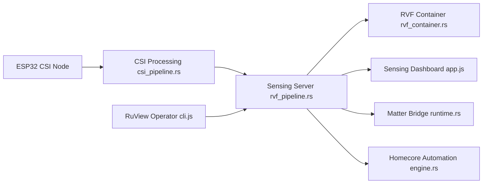

# ruvnet/wifi-densepose

> Camera-less detection platform: ESP32 sensors read the WiFi signal to estimate presence, breathing, and posture.

## The problem
Measure the presence and vital signs of a person in a room without cameras or wearable devices, using equipment costing only a few dollars. Traditional sensors require wiring for each individual.

## What it actually does
ESP32 nodes capture CSI (Channel State Information) from WiFi. A Rust server and embedded modules extract data on presence, count, drop-out, respiratory and heart rates, as well as a 17-point pose. Home Assistant (MQTT) and Matter integrations expose the states. The published figures include caveats: presence 82.3% (previously "100%" removed), embedded pose model to PCK@20 = 3%, runtime still a stub.

## How it is wired


## Trying it
```bash
docker pull ruvnet/wifi-densepose:latest
docker run -p 3000:3000 ruvnet/wifi-densepose:latest
# puis http://localhost:3000 (données simulées)

pip install ruview
python archive/v1/data/proof/verify.py
```

## Cost and gotchas
Docker uses simulated data; the real CSI requires an ESP32-S3 (~$9) or a research network card, costing around $140 with the Cognitum Seed. The README combines several products (a catalogue of 105 modules, a plugin, an MCP, a shop, and an affiliate program).

## What it is not
This is not a medical device or an emergency system: the user manual explicitly states this, and vital functions such as positioning require independent validation. Real-time positioning on a single ESP32 has not been demonstrated. The identification of a person is not claimed (and cannot be done solely via WiFi). Assuming that one is exempt from privacy obligations simply because there is no camera is a shortcut: surveillance of individuals remains subject to local laws (consent, GDPR); and should only be used in locations and for individuals where permission has been granted.

## Alternatives
- `ruvnet/rvcsi`: The standalone CSI runtime, which is lighter and mentioned in the README.

## For you
It's better to test rather than adopt: the volume of ambitions, the single power supply, and the discrepancies around the figures (3% margin) all justify testing on a simulator or an ESP32 development board before any real project.
