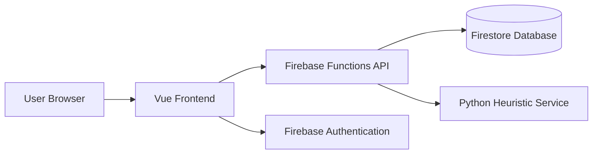

# ruxailab/RUXAILAB

> Open source UX research platform: usability testing and accessibility evaluation, for research teams.

## The problem
Running user studies (recruitment, collection, analysis, heuristics) requires several paid, siloed tools.

## What it actually does
Vue.js 2 + Vuetify front end, Firebase backend (Auth, Firestore, Realtime DB, Storage, Cloud Functions) plus a Python `weight_function` for heuristic weights. Optional external services provide eye tracking, transcription, facial/voice sentiment analysis, PDF (Laravel) and video calls (LiveKit).

## How it is wired


## Trying it
```bash
git clone https://github.com/ruxailab/ruxailab.git
cd ruxailab
npm install
cp .env.example .env
npm run serve
```

## Cost and gotchas
Node 22.22.1 required, a Firebase project (or emulators) to configure. Each optional integration is a separate repo to host. Deploying the functions may touch a shared environment.

## What it is not
Not a turnkey tool: advanced features (eye tracking, sentiment) require deploying several side services. Vue 2 is an aging base.

## Alternatives
The cited integration repos (web-eye-tracker-front, eye-tracker-api, transcription-api) are building blocks, not alternatives.

## For you
Worth watching: the analysis part (sentiment, transcription, eye tracking) touches applied AI for UX, but the Firebase/Vue 2 stack is not your MLOps territory.
