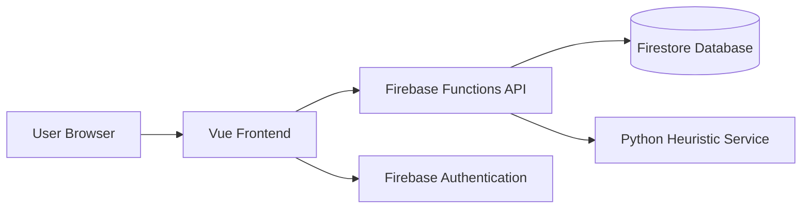

# ruxailab/RUXAILAB

> Plateforme open source de recherche UX : tests d'utilisabilité et évaluation d'accessibilité, pour équipes de recherche.

## Le problème
Mener des études utilisateurs (recrutement, collecte, analyse, heuristiques) demande plusieurs outils payants et cloisonnés.

## Ce que ça fait vraiment
Front Vue.js 2 + Vuetify, backend Firebase (Auth, Firestore, Realtime DB, Storage, Cloud Functions) plus une fonction Python `weight_function` pour les poids d'heuristiques. Des services externes optionnels apportent eye tracking, transcription, analyse de sentiment faciale/vocale, PDF (Laravel) et visio (LiveKit).

## Comment c'est branché


## Essayer
```bash
git clone https://github.com/ruxailab/ruxailab.git
cd ruxailab
npm install
cp .env.example .env
npm run serve
```

## Coût et pièges
Node 22.22.1 exigé, projet Firebase (ou émulateurs) à configurer. Chaque intégration optionnelle est un dépôt séparé à héberger. Déployer les functions peut toucher un environnement partagé.

## Ce que ce n'est pas
Pas un outil clé en main : les fonctions avancées (eye tracking, sentiment) supposent de déployer plusieurs services annexes. Vue 2 est une base vieillissante.

## Alternatives
Les dépôts d'intégration cités (web-eye-tracker-front, eye-tracker-api, transcription-api) sont des briques, pas des alternatives.

## Pour toi
Surveiller : la partie analyse (sentiment, transcription, eye tracking) touche à l'IA appliquée à l'UX, mais la pile Firebase/Vue 2 n'est pas ton terrain MLOps.

