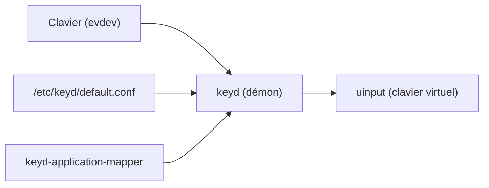

# rvaiya/keyd

> Linux kernel-level key remapping daemon, for users of custom keyboards.

## The problem
Linux has no good key remapping tool, and those that exist depend on X11.

## What it actually does
A system daemon reads evdev events and rewrites keys via uinput. It offers layers, tap/hold dual function (`overload`), one-shot modifiers and per-keyboard configuration. It also works in a virtual console.

## How it is wired


## Trying it
```bash
git clone https://github.com/rvaiya/keyd
cd keyd
make && sudo make install
sudo systemctl enable --now keyd
sudo keyd reload
```

## Cost and gotchas
Free. C compiler and kernel headers. A bad configuration can make the machine unusable (`backspace+escape+enter` stops keyd). Per-application remapping is experimental.

## What it is not
Not a tool for programming every key up/down event. It does not run arbitrary programs as root, by design choice.

## Alternatives
- kmonad: more configurable (extensible in Haskell), but heavier.
- xmodmap / setxkbmap: display-server-level tools, more limited.

## For you
Ignore: keyboard convenience utility on Linux, unrelated to data / AI / MLOps work.
