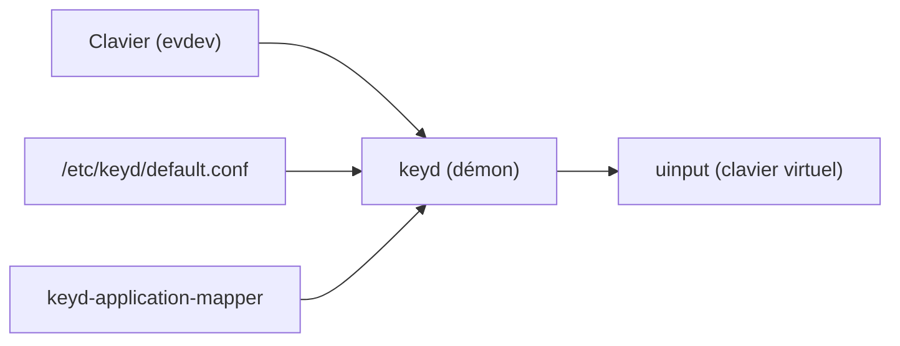

# rvaiya/keyd

> Démon Linux de remappage de touches au niveau du noyau, pour utilisateurs de claviers personnalisés.

## Le problème
Linux n'a pas de bon outil de remappage de touches, et ceux qui existent dépendent de X11.

## Ce que ça fait vraiment
Un démon système lit les événements evdev et réécrit les touches via uinput. Il propose des couches, la double fonction tap/hold (`overload`), des modificateurs à un coup et une configuration par clavier. Il fonctionne aussi dans une console virtuelle.

## Comment c'est branché


## Essayer
```bash
git clone https://github.com/rvaiya/keyd
cd keyd
make && sudo make install
sudo systemctl enable --now keyd
sudo keyd reload
```

## Coût et pièges
Gratuit. Compilateur C et en-têtes du noyau. Une mauvaise configuration peut rendre la machine inutilisable (`backspace+escape+enter` arrête keyd). Le remappage par application est expérimental.

## Ce que ce n'est pas
Ce n'est pas un outil pour programmer chaque événement touche haut/bas. Il n'exécute pas de programmes arbitraires en root, par choix de conception.

## Alternatives
- kmonad : plus configurable (extensible en Haskell), mais plus lourd.
- xmodmap / setxkbmap : outils de niveau serveur d'affichage, plus limités.

## Pour toi
À ignorer : utilitaire de confort pour le clavier sous Linux, sans lien avec un travail data / IA / MLOps.

